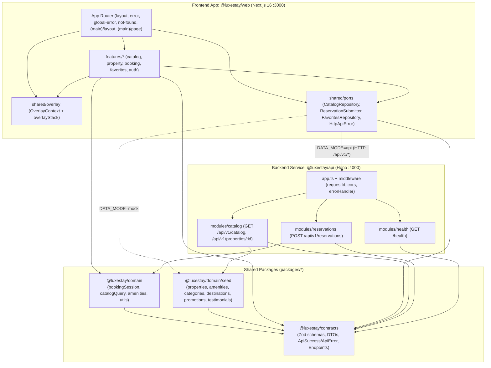
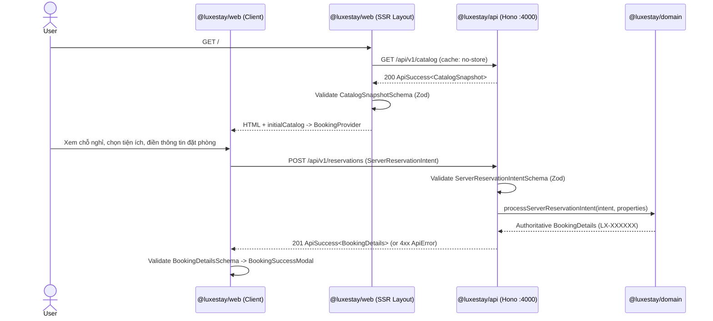

# System & Software Architecture — LuxeStay (`travel-service`)

- **Phiên bản kiến trúc:** 2.0 (Monorepo Baseline v0.2.0)
- **Ngày cập nhật:** 2026-11-24
- **Từ vựng thiết kế & miền:** [GLOSSARY.md](../GLOSSARY.md) & [.agents/skills/codebase-design/SKILL.md](../.agents/skills/codebase-design/SKILL.md)
- **Tài liệu liên quan:** [PRD.md](./PRD.md) | [PLAN.md](./PLAN.md) | [ADR Index](./adr/README.md) | [ADR-0007](./adr/0007-monorepo-hono-zod-contracts.md)

---

## 1. Triết lý Kiến trúc & Ngăn xếp Công nghệ

### 1.1. Ngăn xếp công nghệ (Tech Stack)
| Thành phần | Công nghệ / Phiên bản | Ghi chú |
| :--- | :--- | :--- |
| **Monorepo Toolchain** | `npm workspaces` (`npm 11.9`) + `Turborepo` (`turbo`) | Quản lý 4 workspace (`packages/*`, `apps/*`), cache & dependency graph |
| **Shared Contracts** | `@luxestay/contracts` + `Zod 3` + TypeScript 5 (`strict: true`) | Nguồn chân lý duy nhất cho Zod schemas, DTOs, `ApiSuccess`/`ApiError`, `API_ENDPOINTS` |
| **Shared Domain** | `@luxestay/domain` (100% pure ESM TypeScript) | 4 deep modules thuần (`bookingSession`, `catalogQuery`, `amenities`, `utils`) + `@luxestay/domain/seed` |
| **Backend API (`apps/api`)** | `Hono 4` + `@hono/node-server` + `tsx` (port `4000`) | Thuần ESM, modular `health`/`catalog`/`reservations`, test in-process qua `app.request()` |
| **Frontend Web (`apps/web`)** | Next.js `16.4.6` (App Router, `--webpack`), React `19.3.0`, Tailwind CSS `v4`, Framer Motion `12.4.7`, Lucide React `1.16.0` (port `3000`) | Feature-based đối xứng với Backend, `useSyncExternalStore`, split Contexts, Error Boundaries |
| **Testing & CI** | Node.js `24` (`.nvmrc`) native `node:test`, ESLint `9` (`eslint.boundaries.mjs` cho toàn repo), GitHub Actions CI | **61/61 tests** trên 4 tầng chạy trong `~3.8s`, **0 errors / 0 warnings** |

### 1.2. Nguyên tắc thiết kế cốt lõi
1. **Shared Contracts First (`@luxestay/contracts`):** Mọi payload qua mạng đều định nghĩa bằng Zod schema, dùng chung để validate đầu vào trên `apps/api` và xác thực phản hồi trên `apps/web`.
2. **Pure In-Process Deep Modules (`@luxestay/domain`):** Toàn bộ quy tắc tìm kiếm/lọc, chiếu & duyệt tiện ích, máy trạng thái phiên đặt phòng và tính báo giá chuẩn là hàm thuần không phụ thuộc React, DOM hay HTTP.
3. **Explicit Seams & Data Modes (`apps/web/src/shared/ports`):** Tách sạch đọc (`CatalogRepository`), ghi (`ReservationSubmitter`) và lưu cục bộ (`FavoritesRepository`). Chế độ `NEXT_PUBLIC_DATA_MODE=api|mock` tường minh — ở `api` mode **tuyệt đối không âm thầm fallback**, mọi lỗi `4xx`/`5xx`/mạng hiển thị trung thực qua `HttpApiError`.
4. **Symmetric Domain Layout & Import Boundaries:** `apps/web/src/features/*` đối xứng 1–1 với `apps/api/src/modules/*`; ESLint `no-restricted-imports` chặn mọi vi phạm ranh giới giữa FE, BE và seed data.

---

## 2. Sơ đồ Kiến trúc Tổng thể (Monorepo v0.2.0)



---

## 3. Cấu trúc Thư mục & Bản đồ Workspace

```text
travel-service/
├── .nvmrc                                      # Ghim Node 24 đồng bộ local & CI
├── package.json                                # Root npm workspaces + turbo scripts + shared ESLint devDeps
├── turbo.json                                  # Build/lint/typecheck/test/dev pipeline
├── tsconfig.base.json                          # Shared TS strict + NodeNext ESM base
├── eslint.boundaries.mjs                       # Quy tắc ranh giới import dùng chung cho cả 4 workspaces
├── .env.example                                # Tổng hợp biến môi trường FE & BE
├── .github/workflows/ci.yml                    # CI: lint -> typecheck -> test -> build (dùng .nvmrc)
├── GLOSSARY.md                                 # Từ vựng miền chuẩn
├── docs/                                       # PRD, ARCHITECTURE, PLAN, adr/ (0001..0007), superpowers/
├── packages/
│   ├── contracts/                              # @luxestay/contracts (+ eslint.config.mjs)
│   │   ├── src/{common,catalog,booking,endpoints,index}.ts
│   │   └── tests/contracts.test.ts             # 3 tests
│   └── domain/                                 # @luxestay/domain (+ eslint.config.mjs)
│       ├── src/{utils,amenities,catalogQuery,bookingSession,index}.ts
│       ├── src/seed/{amenities,categories,destinations,promotions,properties,testimonials,index}.ts
│       └── tests/*.test.ts                     # 37 tests (5 files)
└── apps/
    ├── api/                                    # @luxestay/api (Hono :4000)
    │   ├── AGENTS.md                           # Quy tắc cục bộ cho Backend
    │   ├── eslint.config.mjs                   # Kế thừa eslint.boundaries.mjs
    │   ├── .env.example
    │   ├── src/
    │   │   ├── config/env.ts                   # Zod env validation (PORT, CORS_ORIGINS, STORAGE_DRIVER, DATABASE_URL)
    │   │   ├── db/                             # Vị trí chuẩn bị tầng DB Phase 1 (README, client.ts, schema/, migrations/)
    │   │   ├── middleware/{requestId,errorHandler}.ts
    │   │   ├── modules/
    │   │   │   ├── health/routes.ts
    │   │   │   ├── catalog/{repository,service,routes}.ts
    │   │   │   └── reservations/{repository,service,routes}.ts
    │   │   ├── app.ts                          # In-process testable Hono factory
    │   │   └── index.ts                        # @hono/node-server entry
    │   └── tests/api.test.ts                   # 6 integration & env tests
    └── web/                                    # @luxestay/web (Next.js 16 :3000)
        ├── AGENTS.md                           # Quy tắc cục bộ cho Frontend
        ├── .env.example
        ├── next.config.ts                      # transpilePackages + Unsplash remotePatterns
        ├── eslint.config.mjs                   # Next Core Web Vitals + kế thừa eslint.boundaries.mjs
        ├── public/*
        ├── src/
        │   ├── app/
        │   │   ├── layout.tsx                  # Root shell + OverlayProvider
        │   │   ├── error.tsx / global-error.tsx / not-found.tsx
        │   │   └── (main)/{layout,page}.tsx    # force-dynamic SSR CatalogSnapshot loader
        │   ├── features/
        │   │   ├── catalog/*                   # SearchBar, CategoryBar, PropertyList, PropertyCard, FilterModal, Hero, PromotionBanner, TrendingDestinations, Testimonials
        │   │   ├── property/*                  # PropertyModal, PropertyAmenitiesModal, AmenityDetailPanel, AmenityIcon
        │   │   ├── booking/*                   # BookingContext (split 3 contexts), BookingCheckoutModal, BookingSuccessModal
        │   │   ├── favorites/FavoritesDrawer.tsx
        │   │   └── auth/AuthModal.tsx
        │   └── shared/
        │       ├── config/env.ts               # Zod validation (NEXT_PUBLIC_DATA_MODE, API URLs)
        │       ├── overlay/{types,overlayStack,OverlayContext}.ts(x)
        │       ├── ports/{types,errors,catalogPort,persistencePort}.ts
        │       ├── ui/{Badge,Button,Input,Modal}.tsx
        │       ├── layout/{Navbar,Footer}.tsx
        │       └── utils/cn.ts
        └── tests/{register-alias.mjs,overlay-stack.test.ts,persistence-port.test.ts}  # 15 tests
```

---

## 4. Kiến trúc Chi tiết từng Tầng & Module

### 4.1. Shared Contracts (`packages/contracts`)
- **Response Envelope chuẩn hóa:**
  - Thành công: `{ ok: true, data: T, meta?: { requestId, timestamp } }`
  - Lỗi: `{ ok: false, error: { code, message, details? }, meta?: { requestId, timestamp } }`
- **Mã lỗi chuẩn (`ErrorCode`):** `VALIDATION_ERROR`, `NOT_FOUND`, `UNPROCESSABLE_ENTITY`, `INVALID_JSON`, `INTERNAL_ERROR`, `NETWORK_ERROR`, `CONTRACT_MISMATCH`.
- **Zod Schemas cốt lõi:** `CatalogSnapshotSchema`, `PropertySchema`, `GuestInfoSchema` (kèm `VN_PHONE_REGEX` & `EMAIL_REGEX`), `ServerReservationIntentSchema` (strip mọi trường lạ như `pricing`), `BookingDetailsSchema`, `HealthDataSchema`.

### 4.2. Pure Domain Deep Modules (`packages/domain`)
- **`catalogQuery.ts`:** Nguồn chân lý duy nhất `StayCatalogQueryState` + `executeCatalogQuery` (hỗ trợ truyền `categories` & `amenityFilterOptions` từ snapshot), tìm kiếm không dấu tiếng Việt, `ActiveFilterChip`, `QuickSearchTrend`, `getQuickDatePresets`.
- **`amenities.ts`:** `WeakMap`-cached `PropertyAmenityProjection`, Master–Detail `AmenityExplorer` reducer/view model, `AmenityPricingDescriptor`.
- **`bookingSession.ts`:** State machine vòng đời phiên đặt phòng (`idle → previewing → checking-out → confirmed → idle`), one-way seeding từ `SearchCriteria`, `deriveBookingQuote`, và `processServerReservationIntent` dùng chung trực tiếp bởi `@luxestay/api`.

```mermaid
stateDiagram-v2
    [*] --> idle
    idle --> previewing : openPropertySession(property, searchCriteria)
    idle --> checkingOut : startCheckoutSession(property, searchCriteria)
    previewing --> idle : closePreviewSession()
    previewing --> checkingOut : startCheckoutSession(sameProperty)
    checkingOut --> idle : closeCheckoutSession()
    checkingOut --> confirmed : submitBookingSession() succeeds
    confirmed --> idle : dismissConfirmedBooking()
    confirmed --> previewing : openPropertySession(nextProperty)

    state checkingOut as "checking-out"
```

### 4.3. Backend API Service (`apps/api` — Hono)
- **Kiến trúc mỗi module:** `routes.ts` (HTTP + Zod validation) → `service.ts` (use-case orchestration) → `repository.ts` (seam persistence).
- **Endpoints hiện hành:**
  - `GET /health` → `200 ApiSuccess<HealthData>`
  - `GET /api/v1/catalog` → `200 ApiSuccess<CatalogSnapshot>`
  - `GET /api/v1/properties/:id` → `200 ApiSuccess<Property>` | `404 NOT_FOUND`
  - `POST /api/v1/reservations` → `201 ApiSuccess<BookingDetails>` | `400 INVALID_JSON / VALIDATION_ERROR` | `404 NOT_FOUND` | `422 UNPROCESSABLE_ENTITY`
- **Khả năng thay thế DB ở Phase 1:** Chỉ cần cài đặt mới `ApiCatalogRepository` và `ApiReservationRepository` (ví dụ PostgreSQL + Drizzle/Prisma) và truyền vào `createApiApp({ catalogRepository, reservationRepository })`.

### 4.4. Frontend Web App (`apps/web` — Next.js 16)
- **App Router & SSR Build Safety:**
  - `src/app/layout.tsx` chỉ giữ vỏ HTML + `OverlayProvider` (giúp `/_not-found` prerender tĩnh sạch sẽ).
  - `src/app/(main)/layout.tsx` đặt `export const dynamic = "force-dynamic"`, gọi `await loadInitialCatalog()` và nạp `initialCatalog` + `dataMode` + `publicApiBaseUrl` vào `BookingProvider`.
  - `error.tsx`, `global-error.tsx`, `not-found.tsx` xử lý lỗi API/runtime và 404 thân thiện bằng tiếng Việt.
- **Ports & Data Modes (`src/shared/ports/`):**
  - `CatalogRepository`: `createHttpCatalogRepository` (`api` mode) vs `createMockCatalogRepository` (`mock` mode).
  - `ReservationSubmitter`: `createHttpReservationAdapter` (`api` mode, ném `HttpApiError` trung thực cho mọi `4xx`/`5xx`/mạng) vs `createBrowserReservationAdapter` (`mock` mode) vs `createInMemoryReservationAdapter` (tests).
  - `FavoritesRepository`: `createBrowserFavoritesAdapter` (`localStorage` + `storage` cross-tab + `useSyncExternalStore`) vs `createInMemoryFavoritesAdapter`.
- **Overlay Stack Coordinator (`src/shared/overlay/`):** Điều phối 7 lớp phủ (`tier = 0` cho 6 base overlays `z-index: 50+`, `tier = 1` cho `PropertyAmenitiesModal` `z-index: 150+`), duy nhất 1 listener `Escape`, ref-counted body scroll lock và ARIA dialog.

---

## 5. Luồng Dữ liệu End-to-End (FE ↔ Contracts ↔ BE)



---

## 6. Chiến lược Kiểm thử 4 Tầng & Cẩm nang Mở rộng

### 6.1. Bộ kiểm thử tự động (`npm run test` — 61 tests)

| Tầng | Workspace | Tệp test | Số test | Phạm vi |
| :---: | :--- | :--- | :---: | :--- |
| **1** | `@luxestay/contracts` | `packages/contracts/tests/contracts.test.ts` | **3** | Zod schemas, `ApiSuccess`/`ApiError`, strip trường giả mạo, `API_ENDPOINTS` |
| **2** | `@luxestay/domain` | `packages/domain/tests/*.test.ts` (5 files) | **37** | Seed catalog (51 amenities / 12 properties), `WeakMap` projection, Explorer, Pricing Descriptors, `StayCatalogQuery`, `BookingSession`, `processServerReservationIntent` |
| **3** | `@luxestay/api` | `apps/api/tests/api.test.ts` | **6** | In-process Hono routes (`health`, `catalog`, `properties/:id`, `reservations` 201 + 400/404 + anti-tampering) & `STORAGE_DRIVER`/`DATABASE_URL` env validation |
| **4** | `@luxestay/web` | `apps/web/tests/*.test.ts` (2 files) | **15** | Overlay stack (7), `FavoritesRepository` & `useSyncExternalStore` (5), strict `HttpApiError` / `CatalogRepository` / `api|mock` ports & env (3) |

### 6.2. Cẩm nang Mở rộng (Extension Playbook)

| Nhu cầu mở rộng | Điểm chạm kiến trúc chuẩn (Locality) |
| :--- | :--- |
| **Thêm endpoint / tính năng mới đồng bộ FE ↔ BE** | 1. Định nghĩa Zod request/response schema + path trong `packages/contracts/src/`<br>2. Viết logic nghiệp vụ thuần trong `packages/domain/src/` (nếu có)<br>3. Cài đặt `repository` / `service` / `routes` trong `apps/api/src/modules/<domain>/` + test in-process<br>4. Thêm/cập nhật adapter trong `apps/web/src/shared/ports/` và UI trong `apps/web/src/features/<domain>/`<br>5. Chạy `npm run lint && npm run typecheck && npm run test && npm run build` |
| **Thay Database thật cho Backend (Phase 1)** | 1. Cài đặt DB adapter thỏa `ApiCatalogRepository` và `ApiReservationRepository` trong `apps/api/src/modules/*`<br>2. Truyền vào `createApiApp(...)` tại `apps/api/src/index.ts`<br>3. Không cần sửa `packages/contracts`, `packages/domain` hay `apps/web` |
| **Thêm tiêu chí lọc / tiện ích mới** | 1. Cập nhật schema ở `packages/contracts`<br>2. Cập nhật `packages/domain/src/catalogQuery.ts` hoặc `packages/domain/src/seed/amenities.ts`<br>3. Nối UI ở `apps/web/src/features/catalog/` |
| **Thêm Modal / Drawer mới** | 1. Thêm `OverlayKind` ở `apps/web/src/shared/overlay/types.ts`<br>2. Dùng `<Modal />` hoặc `useOverlayLayer({ id, kind, isOpen, onClose, tier })` |

---

## 7. Giới hạn Hiện tại (Đã thu gọn sau Monorepo v0.2.0)

1. **Lưu trữ trong bộ nhớ trên `apps/api`:** `createSeedCatalogRepository` và `createInMemoryReservationRepository` chưa nối Database thật (mục tiêu trọng tâm của **Phase 1** trong [PLAN.md](./PLAN.md)).
2. **Chưa có route `/stays/[id]` và đồng bộ URL query params:** Toàn bộ khám phá vẫn diễn ra qua modal tại `/` (mục tiêu **P1.3**).
3. **Các luồng thương mại nâng cao vẫn ở mức UI prototype:** `AuthModal`, mã giảm giá động `PromotionBanner`, cổng thanh toán thực tế (`MoMo`/`VNPAY`/`Card`), đa ngôn ngữ (mục tiêu **Phase 2–3**).
