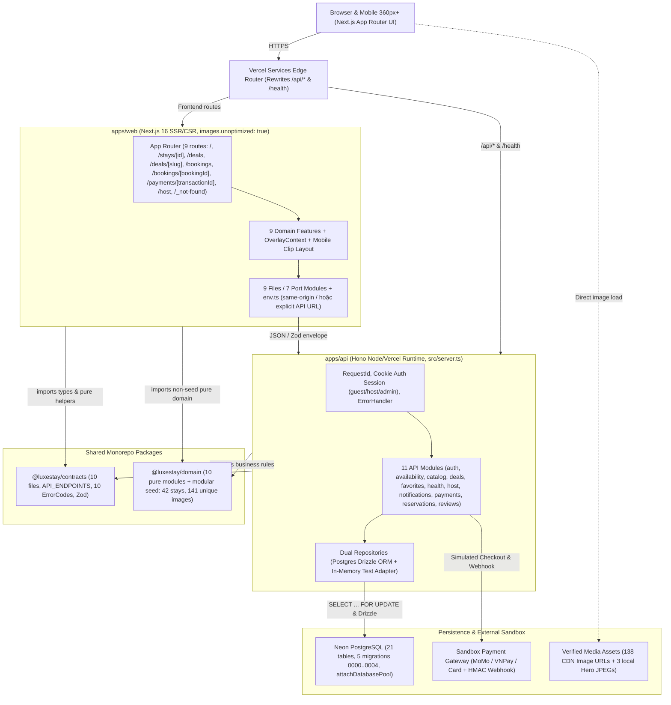

# System & Software Architecture — LuxeStay

> **Version:** `3.0`  
> **Last Updated:** `2026-11-25`  
> **Trạng thái Scope:** `Phase 0 – Phase 4C (Completed)` + `Phase 5 Runway (Planned)`  
> **Tài liệu liên quan:** [PRD.md](./PRD.md) (`v2.0`) · [PLAN.md](./PLAN.md) (`v3.0`) · [DEPLOYMENT.md](./DEPLOYMENT.md) · [GLOSSARY.md](../GLOSSARY.md) · [adr/README.md](./adr/README.md)

---

## 1. Kiến trúc tổng thể & Triết lý

**LuxeStay** là nền tảng đặt phòng nghỉ dưỡng cao cấp tại Việt Nam được tổ chức theo mô hình **Monorepo Modular Architecture (Ports & Adapters)** với **Strict Unidirectional Dependency Layering** được kiểm soát tự động qua [`eslint.boundaries.mjs`](../eslint.boundaries.mjs).

### Bốn nguyên lý kiến trúc cốt lõi (tính đến Phase 4C)
1. **Contract-First & Deep Domain Modules:** Mọi DTO, Zod schema, endpoint path (`API_ENDPOINTS`), và mã lỗi chuẩn hóa đều xuất phát từ [`@luxestay/contracts`](../packages/contracts/src/index.ts); toàn bộ business logic thuần (tính giá, tồn kho theo ngày, voucher, booking state, media catalog 4 trục) nằm trong [`@luxestay/domain`](../packages/domain/src/index.ts) không phụ thuộc framework hay DB driver.
2. **Ports & Adapters + Fail-Fast API Mode:** `apps/web` chỉ giao tiếp dữ liệu qua lớp port ở [`apps/web/src/shared/ports/`](../apps/web/src/shared/ports/types.ts) (9 file gồm 7 port implementation modules + `types.ts` + `errors.ts`, định nghĩa 9 port interfaces), tuyệt đối không import trực tiếp `apps/api`, `hono`, hay `@luxestay/domain/seed`. Khi `NEXT_PUBLIC_DATA_MODE=api`, client báo lỗi có cấu trúc nếu API thất bại, không silently fall back sang seed/mock data.
3. **Server-Authoritative Pricing & Atomic Inventory:** Tổng tiền, phụ phí mùa/cuối tuần, giảm giá voucher, và số phòng trống được server tính lại từ DB trong transaction cô lập (`SELECT ... FOR UPDATE` trên PostgreSQL; per-property async lock trong in-memory test repository), chống double-booking và client price tampering.
4. **Idempotent Lifecycle & Authentic Seed Media:** Script khởi tạo DB [`vercelPrepare.ts`](../apps/api/src/db/vercelPrepare.ts) chỉ backfill dữ liệu còn thiếu và sửa URL ảnh cũ bằng conditional updates (`repairRetiredSeedImages`), đảm bảo 42 chỗ nghỉ với **141 media slots** duy nhất (0% trùng lặp toàn cục) được bảo chứng bởi [`verify-seed-images.mjs`](../scripts/verify-seed-images.mjs).

---

## 2. Sơ đồ hệ thống (System Topology)



---

## 3. Monorepo & Folder Structure

```text
travel-service/
├── package.json                          # npm workspaces + Turbo scripts (build, typecheck, lint, test, test:e2e)
├── turbo.json                            # Pipeline build/lint/typecheck/test orchestration
├── vercel.json                           # Vercel Services Beta (frontend + backend + rewrites + db:prepare)
├── eslint.boundaries.mjs                 # Enforces strict Contracts -> Domain -> Apps layer rules
├── GLOSSARY.md                           # Từ vựng miền nghiệp vụ chuẩn hóa
├── .github/workflows/ci.yml              # CI gate (typecheck, lint, build, unit/integration tests)
├── scripts/
│   └── verify-seed-images.mjs            # Audit 141 seed media slots (0% duplicate, HTTP 200 image/*, local asset byte bounds)
├── e2e/
│   └── luxestay.spec.ts                  # Playwright E2E suite (E2E-1 .. E2E-6) trên cổng cô lập 4100/3100
├── docs/
│   ├── ARCHITECTURE.md                   # File này (v3.0)
│   ├── PRD.md                            # Product Requirements Document (v2.0)
│   ├── PLAN.md                           # Execution Roadmap & Milestones M0..M15 (v3.0)
│   ├── DEPLOYMENT.md                     # Hướng dẫn chạy local, Docker/Neon Postgres & Vercel Services
│   ├── adr/                              # Architecture Decision Records (0000..0012 + README.md)
│   └── superpowers/                      # Specs & Implementation Plans qua từng phase
├── packages/
│   ├── contracts/                        # @luxestay/contracts
│   │   ├── src/
│   │   │   ├── auth.ts, availability.ts, booking.ts, catalog.ts, common.ts
│   │   │   ├── deals.ts, endpoints.ts, host.ts, payment.ts, index.ts
│   │   └── tests/contracts.test.ts       # 8 tests
│   └── domain/                           # @luxestay/domain
│       ├── src/
│       │   ├── amenities.ts, availability.ts, bookingSession.ts, catalogQuery.ts
│       │   ├── deals.ts, host.ts, locale.ts, reviews.ts, utils.ts, vouchers.ts, index.ts
│       │   └── seed/
│       │       ├── amenities.ts          # 51 tiện ích chuẩn hóa (AMENITY_CATALOG) + filter options
│       │       ├── categories.ts         # 9 danh mục (CATEGORIES)
│       │       ├── destinations.ts       # 8 điểm đến xu hướng (DESTINATIONS)
│       │       ├── promotions.ts         # 6 vouchers + 5 campaigns
│       │       ├── testimonials.ts       # 3 đánh giá nổi bật
│       │       ├── retiredImages.ts      # Sổ cái ảnh cũ đã loại biên cho repairRetiredSeedImages(db)
│       │       ├── properties.ts         # Tổng hợp 42 chỗ nghỉ trên 14 thành phố
│       │       ├── properties/           # villas.ts, resorts.ts, homestays.ts, hotels.ts, glamping.ts, types.ts
│       │       └── index.ts
│       └── tests/                        # 8 test files (56 tests)
└── apps/
    ├── api/                              # @luxestay/api (Hono HTTP + Drizzle ORM)
    │   ├── src/
    │   │   ├── app.ts, index.ts, server.ts, runtime.ts, types.ts
    │   │   ├── config/env.ts
    │   │   ├── middleware/               # auth.ts, errorHandler.ts, requestId.ts
    │   │   ├── db/
    │   │   │   ├── client.ts, migrate.ts, seed.ts, vercelPrepare.ts
    │   │   │   ├── schema/               # auth.ts (4), catalog.ts (12), payments.ts (3), reservations.ts (2), index.ts
    │   │   │   └── migrations/           # 0000_initial.sql .. 0004_promotions_campaigns.sql + meta/_journal.json
    │   │   └── modules/                  # 11 modules: auth, availability, catalog, deals, favorites,
    │   │                                 # health, host, notifications, payments, reservations, reviews
    │   └── tests/api.test.ts             # 21 integration tests
    └── web/                              # @luxestay/web (Next.js App Router + Tailwind + Shadcn patterns)
        ├── next.config.ts                # images.unoptimized: true + transpilePackages
        ├── public/images/stays/          # AI-verified hero JPEGs (stay-01-hero.jpg, stay-15-hero.jpg, stay-18-hero.jpg)
        ├── src/
        │   ├── app/                      # globals.css (overflow-x: clip), layout.tsx, error.tsx, global-error.tsx, not-found.tsx
        │   │   └── (main)/               # page.tsx, layout.tsx, stays/[id], deals, deals/[slug],
        │   │                             # bookings, bookings/[bookingId], payments/[transactionId], host
        │   ├── features/                 # 9 features: auth, booking, catalog, favorites, host,
        │   │                             # locale, payment, promotions, property
        │   └── shared/
        │       ├── config/env.ts         # PublicWebEnv & ServerWebEnv URL normalization
        │       ├── layout/               # Navbar.tsx, Footer.tsx
        │       ├── overlay/              # OverlayContext.tsx, overlayStack.ts, types.ts
        │       ├── ports/                # authPort, catalogPort, dealsPort, experiencePort,
        │       │                         # hostPort, paymentPort, persistencePort, errors, types
        │       ├── ui/, utils/
        └── tests/                        # 3 test files (32 tests)
```

---

## 4. Chi tiết từng Layer & Data Flows

### 4.1 `@luxestay/contracts`
- Gồm **10 file** nguồn định nghĩa toàn bộ ranh giới JSON giữa `apps/web` và `apps/api`: [`auth.ts`](../packages/contracts/src/auth.ts), [`availability.ts`](../packages/contracts/src/availability.ts), [`booking.ts`](../packages/contracts/src/booking.ts), [`catalog.ts`](../packages/contracts/src/catalog.ts), [`common.ts`](../packages/contracts/src/common.ts), [`deals.ts`](../packages/contracts/src/deals.ts), [`endpoints.ts`](../packages/contracts/src/endpoints.ts), [`host.ts`](../packages/contracts/src/host.ts), [`payment.ts`](../packages/contracts/src/payment.ts), [`index.ts`](../packages/contracts/src/index.ts).
- Chuẩn hóa envelope `ApiSuccess<T>` / `ApiError` và **10 `ErrorCode`**: `UNAUTHORIZED`, `FORBIDDEN`, `NOT_FOUND`, `CONFLICT`, `VALIDATION_ERROR`, `UNPROCESSABLE_ENTITY`, `INVALID_JSON`, `INTERNAL_ERROR`, `NETWORK_ERROR`, `CONTRACT_MISMATCH`.
- Khai báo tập trung hằng số `API_ENDPOINTS` cho toàn bộ **30 route patterns/entries** (catalog, deals, availability, reviews, vouchers, reservations, auth/OTP, favorites, payments/webhooks, host portal, health).

### 4.2 `@luxestay/domain`
- Gồm **10 pure modules** không phụ thuộc Node/Web/SQL I/O:
  - [`catalogQuery.ts`](../packages/domain/src/catalogQuery.ts): lọc đa chiều (điểm đến/từ khóa, ngày, số khách/phòng, khoảng giá, category, nhiều amenity filter keys), sắp xếp, và phân trang tiến dần.
  - [`availability.ts`](../packages/domain/src/availability.ts): `evaluatePropertyAvailability` và `buildAvailabilityCalendar` tính tồn kho còn lại theo ngày (`property_availability`), áp dụng phụ phí mùa/cuối tuần (`nightlyBreakdown`, `seasonalSurcharge`), và kiểm tra chặn ngày (`isBlocked`).
  - [`bookingSession.ts`](../packages/domain/src/bookingSession.ts): quản trị state đặt phòng, `deriveBookingQuote`, `calculateBookingPricing` (`CLEANING_FEE = 150000`, `serviceFee = 0`), và validate input khách đặt phòng.
  - [`vouchers.ts`](../packages/domain/src/vouchers.ts) & [`deals.ts`](../packages/domain/src/deals.ts): kiểm tra 8 `VoucherErrorReason` (bao gồm `NEW_USER_ONLY` và `PROPERTY_NOT_ELIGIBLE`), ghép campaign nổi bật / danh sách chiến dịch `/deals` / `/deals/[slug]`.
  - [`amenities.ts`](../packages/domain/src/amenities.ts): phân tách 51 tiện ích (`AMENITY_CATALOG`) theo 3 loại `AmenityPricingTypeSchema` (`included`, `free-reservation`, `paid`) cho modal/detail page.
  - [`host.ts`](../packages/domain/src/host.ts), [`reviews.ts`](../packages/domain/src/reviews.ts), [`locale.ts`](../packages/domain/src/locale.ts), [`utils.ts`](../packages/domain/src/utils.ts).
- **Modular Seed Architecture (`packages/domain/src/seed/`):**
  - **42 chỗ nghỉ** (`stay-01`..`stay-42`) tách module theo loại hình tại [`properties/`](../packages/domain/src/seed/properties/types.ts) (`villas.ts`, `resorts.ts`, `homestays.ts`, `hotels.ts`, `glamping.ts`), phủ **14 thành phố** tại Việt Nam cùng **8 Trending Destinations**, **9 Categories**, **6 Vouchers**, **5 Campaigns**, **51 Amenities**, **3 Testimonials**.
  - Tuân thủ kỷ luật **0% trùng lặp toàn cục qua 141 media slots** (42 chỗ nghỉ × ảnh chính + gallery + 8 điểm đến + 5 campaigns) và căn chỉnh **4 trục** (loại hình, vùng miền/cảnh quan, phân khúc giá, đúng `resortAmenities`). Địa chỉ đường phố tách biệt tên thành phố khác để tránh false-positive khi search. Các URL cũ thay thế được lưu ở [`retiredImages.ts`](../packages/domain/src/seed/retiredImages.ts).

### 4.3 `apps/api` & Neon PostgreSQL
**11 API Modules & 33 HTTP Handlers:**

| Module | Routes đảm nhiệm | Trách nhiệm chính |
| :--- | :--- | :--- |
| `health` | `GET /health` | Readiness & DB ping check |
| `catalog` | `GET /api/v1/catalog`, `GET /api/v1/properties/:id`, `POST /api/v1/vouchers/validate` | Trả danh mục (kèm `reviews` của từng property), chi tiết chỗ nghỉ, kiểm tra voucher phía server |
| `deals` | `GET /api/v1/deals`, `GET /api/v1/deals/:slug` | Danh sách chiến dịch ưu đãi & trang chi tiết campaign |
| `availability` | `GET /api/v1/properties/:id/availability` | Lịch trống theo khoảng ngày & `nightlyBreakdown` |
| `reviews` | `POST /api/v1/properties/:id/reviews` | Tạo nhận xét đã xác thực & cập nhật điểm đánh giá (đọc review nằm trong `catalog` / `properties/:id`) |
| `reservations` | `POST /api/v1/reservations`, `GET /api/v1/reservations/my`, `GET /api/v1/reservations/:bookingId`, `GET .../notifications`, `PATCH .../cancel`, `POST .../complete` | Tạo đơn nguyên tử (`SELECT ... FOR UPDATE`), tra cứu, hủy (`PATCH`)/hoàn tất (`POST`) & nhật ký thông báo |
| `auth` | `GET /api/v1/auth/me`, `POST /api/v1/auth/register`, `login`, `logout`, `otp/request`, `otp/verify` | Session cookie, băm mật khẩu, OTP & RBAC (`guest`, `host`, `admin` theo `UserRoleSchema`) |
| `favorites` | `GET /api/v1/favorites`, `PUT /api/v1/favorites`, `POST /api/v1/favorites/:propertyId/toggle` | Đồng bộ danh sách & bật/tắt chỗ nghỉ yêu thích của thành viên |
| `payments` | `GET /api/v1/payments/:transactionId`, `POST .../simulate`, `POST /api/v1/payments/webhook/:provider` | Thanh toán sandbox (`momo`/`vnpay`/`card`), HMAC signature & webhook idempotency |
| `host` | `GET/POST /api/v1/host/properties`, `PATCH/DELETE /api/v1/host/properties/:id`, `PUT .../availability`, `GET /api/v1/host/reservations`, `GET /api/v1/host/analytics` | Cổng Chủ nhà/Quản trị RBAC (`host`/`admin`) quản lý tài sản, tồn kho/giá theo ngày & doanh thu |
| `notifications` | *(Internal service used by reservations & payments)* | Ghi log xác nhận đặt phòng/thanh toán vào `notification_logs` |

**Cơ sở dữ liệu PostgreSQL (21 bảng trong 4 Schema files + 5 Migrations):**
- [`auth.ts`](../apps/api/src/db/schema/auth.ts) **(4 bảng):** `users`, `user_sessions`, `otp_challenges`, `user_favorites`.
- [`catalog.ts`](../apps/api/src/db/schema/catalog.ts) **(12 bảng):** `categories`, `destinations`, `promotions`, `promotion_campaigns`, `testimonials`, `amenity_categories`, `amenity_filter_options`, `amenity_catalog`, `properties`, `property_amenities`, `property_availability`, `reviews`.
- [`reservations.ts`](../apps/api/src/db/schema/reservations.ts) **(2 bảng):** `reservations`, `reservation_amenities`.
- [`payments.ts`](../apps/api/src/db/schema/payments.ts) **(3 bảng):** `payment_transactions`, `payment_webhook_events`, `notification_logs`.
- **Migrations (`apps/api/src/db/migrations/`):** `0000_initial.sql`, `0001_phase2_commercialization.sql`, `0002_phase3a_availability_reviews.sql`, `0003_phase3b_rbac_host_portal.sql`, `0004_promotions_campaigns.sql`.
- **Idempotent Deploy Preparation (`vercelPrepare.ts`):** Chạy migration mới nhất và đồng bộ dữ liệu an toàn qua 3 cơ chế không ghi đè dữ liệu hiện hữu của host/user: `backfillPromotionsIfNeeded`, `backfillMissingSeedProperties`, và `repairRetiredSeedImages` (conditional `UPDATE` chỉ khớp URL cũ đã loại biên trong `retiredImages.ts`).

### 4.4 `apps/web`
- **9 App Router Routes (`apps/web/src/app/(main)/`):**
  1. `/` — Trang chủ discovery, Promotions Hub 3 tầng, Carousel & Progressive `PropertyList`
  2. `/stays/[id]` — Trang chi tiết chỗ nghỉ chuyên sâu + Availability Calendar + Reviews
  3. `/deals` — Trung tâm ưu đãi tổng hợp (filter chiến dịch & voucher)
  4. `/deals/[slug]` — Landing page từng chiến dịch ưu đãi, hiển thị các chỗ nghỉ áp dụng và kích hoạt `BookingContext.openPropertyWithPromo` / `startCheckoutWithPromo` (lưu `BookingSession.promoCode` trong bộ nhớ)
  5. `/bookings` — Tra cứu & lịch sử đơn đặt phòng
  6. `/bookings/[bookingId]` — Chi tiết đơn, hủy đơn & lịch sử thông báo
  7. `/payments/[transactionId]` — Cổng mô phỏng thanh toán MoMo / VNPay / Card
  8. `/host` — Cổng quản trị Chủ nhà (RBAC guarded)
  9. `/_not-found` — Custom 404/error boundaries (`not-found.tsx`, `error.tsx`, `global-error.tsx`)
- **9 Feature Slices (`apps/web/src/features/`):** `auth`, `booking`, `catalog`, `favorites`, `host`, `locale`, `payment`, `promotions`, `property`.
- **URL & Port Resolution (`shared/config/env.ts` & `shared/ports/`):** Gồm **9 files** (**7 port modules** bao gồm `experiencePort.ts` cho `PropertyExperiencePort` đã chạy từ Phase 3A, cùng `types.ts` và `errors.ts`). Hỗ trợ cả explicit URL (`http://localhost:4000`) cho local/E2E và same-origin token (`NEXT_PUBLIC_API_BASE_URL=/` chuẩn hóa thành `""`) cho Vercel Services, kết hợp server-side `API_BASE_URL` / `VERCEL_URL` cho SSR.
- **Responsive Mobile & Overlay Stack:** `OverlayContext` (`overlayStack.ts`) quản lý ngăn xếp modal/drawer (`Esc`/backdrop LIFO); CSS root đặt `html, body { max-width: 100%; overflow-x: clip; }`, mọi grid/carousel/section trang chủ bọc `w-full min-w-0` và giới hạn chiều rộng popover `SearchBar` để giữ `scrollWidth <= innerWidth` từ `360px` trở lên. `PromotionsHub` phân 3 tầng: Tier 1 `VoucherCarousel` (tối đa 5 voucher active non-member-only), Tier 2 `CampaignHeroBanner` (1 hero campaign), Tier 3 `CampaignCarousel` (4 carousel campaigns).

---

## 5. Deployment Architecture (Vercel Services + Neon)

Dự án triển khai một repo lên **Vercel Services (Beta)** thông qua [`vercel.json`](../vercel.json):
- **`services.frontend` (`apps/web`, Next.js):** Giao tiếp API cùng origin qua rewrites `/api/:path*` -> `services.backend` và `/health` -> `services.backend`. Trong [`next.config.ts`](../apps/web/next.config.ts), `images.unoptimized: true` bắt buộc được bật vì `/_next/image` trả `404` dưới service rewrites (ảnh remote sử dụng trực tiếp CDN params; ảnh nội bộ lưu tại `apps/web/public/images/stays/`).
- **`services.backend` (`apps/api`, entrypoint `src/server.ts`):** `buildCommand` xóa `apps/api/dist` trước khi chạy `npm run db:prepare` để `@vercel/backends` bundle `src/server.ts` thành `.mjs` sạch (tránh load nhầm `dist/app.js` CommonJS). Kết nối Neon Postgres gắn `@vercel/functions` `attachDatabasePool` tại [`client.ts`](../apps/api/src/db/client.ts).
- **CI Workflow ([`.github/workflows/ci.yml`](../.github/workflows/ci.yml)):** Kiểm tra tự động `typecheck`, `lint`, `build`, và toàn bộ suite `test` trên mỗi push/PR.

---

## 6. Verification, Quality Gates & Extension Playbook

### 6.1 Test & Verification Matrix (Phase 0 – 4C)

| Tầng kiểm thử | Đường dẫn | Quy mô thực tế | Mục tiêu bảo chứng |
| :--- | :--- | :--- | :--- |
| **Contracts** | [`contracts.test.ts`](../packages/contracts/tests/contracts.test.ts) | **8 tests** | Zod schemas, error envelopes, `API_ENDPOINTS` |
| **Domain** | [`packages/domain/tests/`](../packages/domain/tests/booking-session.test.ts) (8 files) | **56 tests** | Amenities (51), Catalog query (42 stays), Availability/Seasonal price, Booking quotes, Vouchers/Deals, Host/Locale |
| **API Integration** | [`api.test.ts`](../apps/api/tests/api.test.ts) | **21 tests** | CRUD, Auth/OTP, Atomic booking lock, Payment webhook HMAC, Host RBAC, Deals |
| **Web Unit/UI** | [`apps/web/tests/`](../apps/web/tests/promotions-hub.test.ts) (3 files) | **32 tests** | Overlay stack, PersistencePort fail-fast & URL norm, PromotionsHub helpers |
| **Media Audit** | [`verify-seed-images.mjs`](../scripts/verify-seed-images.mjs) | **141 slots** | `0` duplicate URL, HTTP `200 image/*` (138 remote) & size bounds `5–350 KB` (3 local AI JPEGs) |
| **E2E Browser** | [`luxestay.spec.ts`](../e2e/luxestay.spec.ts) | **6 flows (`E2E-1`..`E2E-6`)** | Discovery -> Booking -> Payment -> Auth/Favorites -> Deals -> Load More -> Mobile `390×844`/`360×800` overflow check |
| **Static Gates** | Root Turbo scripts | **4 gates** | `npm run build`, `npm run typecheck`, `npm run lint`, `npm run test` (**117 tests tổng**) |

> Lưu ý chạy E2E song song dev server: dùng cổng cô lập `E2E_API_PORT=4100 E2E_WEB_PORT=3100 npm run test:e2e`.

### 6.2 Extension Playbook — Phase 5 Runway (`Activities, Tours & Transfers`)
Theo lộ trình [PLAN.md v3.0](./PLAN.md), khi mở rộng sang **Phase 5 (`Activities, Tours & Transfers`)**, thực hiện đúng chuỗi dọc sau để giữ ranh giới sạch với [`experiencePort.ts`](../apps/web/src/shared/ports/experiencePort.ts) (vốn phục vụ `PropertyExperiencePort` từ Phase 3A):
1. **Contracts (`@luxestay/contracts`):** Bổ sung DTOs/Zod schemas cho dịch vụ trải nghiệm & đưa đón (hoạt động, khung giờ, combo/bundle) và mở rộng `booking.ts` + `endpoints.ts`.
2. **Domain (`@luxestay/domain`):** Viết pure helpers cho lịch khởi hành, tính giá bundle cross-sell và hoàn/hủy từng hạng mục; bổ sung `packages/domain/src/seed/activities/*` tuân thủ kỷ luật **4 trục + 0% trùng lặp ảnh**.
3. **Database (`apps/api/src/db/`):** Tạo migration `0005_travel_activities.sql` lưu danh mục hoạt động/đưa đón & liên kết đặt chỗ đa dịch vụ kèm backfill idempotent trong `vercelPrepare.ts`.
4. **API (`apps/api/src/modules/`):** Thêm `apps/api/src/modules/activities/*` và mở rộng transaction đặt chỗ trong `reservations` + `payments` hỗ trợ giỏ hàng đa dịch vụ.
5. **Ports & Web (`apps/web/src/`):** Thêm port mới `activitiesPort.ts`, tạo tuyến `/activities` và `/activities/[slug]`, cùng luồng cross-sell combo trong checkout và `/bookings/[bookingId]`.
6. **Audit & E2E (`P5.3`):** Cập nhật [`verify-seed-images.mjs`](../scripts/verify-seed-images.mjs) bao phủ ảnh trải nghiệm và viết kịch bản **`E2E-7`** (*Booking bundle stay + airport transfer & partial cancellation*).

---

## 7. Known Architectural Boundaries & Guardrails

1. **`images.unoptimized: true` dưới Vercel Services (Beta):** `/_next/image` trả `404` qua service rewrites. Nếu chuyển hosting hỗ trợ Next Image Optimizer độc lập, mới bật lại optimization và kiểm tra `verify-seed-images.mjs`.
2. **Bảo vệ build `@vercel/backends`:** Bắt buộc dọn `apps/api/dist` trong `vercel.json` trước khi bundle `src/server.ts` để tránh CommonJS fallback (`dist/app.js`).
3. **Lock Mechanism Dualism:** Môi trường Postgres dùng transaction + `SELECT ... FOR UPDATE`; test suite API dùng in-memory per-property async mutex (`createInMemoryReservationRepository`) nên mọi kiểm tra race condition mức DB cần verify thêm với PostgreSQL thật khi thay đổi query.
4. **Payment & Webhook Sandbox:** Cổng `/payments/[transactionId]` mô phỏng giao dịch thanh toán + chữ ký HMAC để phát triển và E2E; trước khi tích hợp PSP thật cần tách secret rotation, webhook retry queue, và đối soát bất đồng bộ.
5. **Danh mục ADR đã chốt ([`docs/adr/`](./adr/README.md)):**
   - `0001` Deep Module Architecture & Domain Seams
   - `0002` Booking Session & Server-Authoritative Pricing
   - `0003` Stay Catalog Query Single Source of Truth
   - `0004` Amenity Projection Explorer & Pricing Descriptors
   - `0005` Centralized Overlay Stack Coordinator
   - `0006` App Ports Persistence & Split Domain Contexts
   - `0007` Monorepo, Hono & Zod Contracts
   - `0008` PostgreSQL + Drizzle Database Layer
   - `0009` Custom Session Auth & Wishlist Sync
   - `0010` Payment Sandbox, Webhook & Notifications
   - `0011` Availability Engine, Seasonal Pricing & Verified Reviews
   - `0012` RBAC Host Portal, i18n & Playwright E2E
