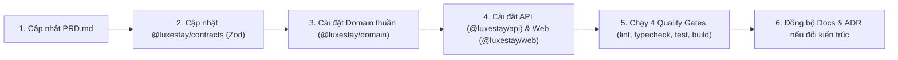

# Engineering, Maintenance & Feature Expansion Plan — LuxeStay (`travel-service`)

- **Phiên bản kế hoạch:** 2.4 (Phase 3 Completed — Baseline v0.6.0)
- **Ngày cập nhật:** 2026-11-24
- **Trạng thái:** All Planned Phases (0–3) Completed ✅
- **Tài liệu liên quan:** [PRD.md](./PRD.md) | [ARCHITECTURE.md](./ARCHITECTURE.md) | [ADR Index](./adr/README.md) | [GLOSSARY.md](../GLOSSARY.md)

---

## 1. Ảnh chụp Hiện trạng (Baseline Snapshot — 2026-11-24)

### 1.1. Các mốc kiến trúc đã hoàn thành (Completed Milestones)
| Mốc | Commit / Phiên bản | Nội dung đã hoàn tất | Hồ sơ thiết kế / ADR |
| :--- | :---: | :--- | :--- |
| **M0 — Khởi tạo MVP** | `9c20f2a` | Nền tảng đặt phòng LuxeStay với Next.js App Router, Tailwind CSS v4, Framer Motion | — |
| **M1 — Resort Amenities** | `96a3216` | Danh mục 51 tiện ích / 7 nhóm, modal chi tiết tiện ích, đồng bộ add-on vào báo giá | [Spec](./superpowers/specs/2026-11-20-resort-amenities-design.md) |
| **M2 — BookingSession Deepening** | `61cf2d6` | Deep module `bookingSession`, seed một chiều từ `SearchBar`, `BookingQuote`, seam `ReservationSubmitter` | [ADR-0002](./adr/0002-booking-session-and-authoritative-server-pricing.md) |
| **M3 — StayCatalogQuery Deepening** | `0476330` | Deep module `catalogQuery`, tìm kiếm tiếng Việt không dấu, preset giá, `ActiveFilterChip`, `QuickSearchTrend` | [ADR-0003](./adr/0003-stay-catalog-query-single-source-of-truth.md) |
| **M4 — Amenity Projection & Explorer** | `dc9d3a7` | `WeakMap` projection, Master–Detail `AmenityExplorer`, `AmenityPricingDescriptor`, xóa schema cũ | [ADR-0004](./adr/0004-amenity-projection-explorer-and-pricing-descriptors.md) |
| **M5 — Overlay Stack Coordinator** | `f467d47` | Deep module `overlayStack` + `OverlayContext`, `z-index` theo tier, 1 listener `Escape`, ref-counted scroll lock, ARIA | [ADR-0005](./adr/0005-centralized-overlay-stack-coordinator.md) |
| **M6 — Persistence & Reservation Ports** | `0f26b7b` | `AppPorts`, `FavoritesRepository` với `useSyncExternalStore`, tách hoàn toàn I/O khỏi domain | [ADR-0006](./adr/0006-app-ports-persistence-and-split-domain-contexts.md) |
| **M7 — Server API & Split Contexts** | `abedd20`, `eb4674e` | Tính giá chuẩn phía server, tách 3 domain contexts (`useFavorites`, `useCatalog`, `useBookingSession`), nâng Next.js `16.4.6` | [ADR-0002](./adr/0002-booking-session-and-authoritative-server-pricing.md), [ADR-0006](./adr/0006-app-ports-persistence-and-split-domain-contexts.md) |
| **M8 — Monorepo v0.2.0 & Phase 0 Hardening** | `bbcc2d6` (`v0.2.0`) | Chuyển đổi sang TypeScript Monorepo (`npm workspaces` + `Turborepo`): `@luxestay/contracts` (Zod), `@luxestay/domain`, `@luxestay/api` (Hono `:4000`), `@luxestay/web` (feature-based `:3000`), `NEXT_PUBLIC_DATA_MODE=api|mock` không fallback ngầm, Error Boundaries, `.nvmrc`, `apps/web/AGENTS.md` + `apps/api/AGENTS.md`, ESLint boundary toàn repo, GitHub Actions CI | [ADR-0007](./adr/0007-monorepo-hono-zod-contracts.md) |
| **M9 — Phase 1: PostgreSQL/Drizzle, Booking Lifecycle & Shareable Routing** | `bc04ca3` (`v0.3.0`) | PostgreSQL 16 + Drizzle ORM (`docker-compose.yml` `:5434->5432`, 12 bảng, migration `0000`, idempotent seed, dual driver `memory|database`), tra cứu & hủy đơn (`/bookings`, `/bookings/[bookingId]`), trang chi tiết `/stays/[id]` SSR + SEO/OpenGraph & đồng bộ URL query | [ADR-0008](./adr/0008-postgresql-drizzle-database-layer.md) |
| **M10 — Phase 2: Commercialization (Auth, Wishlist Sync, Voucher Engine & Payment Sandbox)** | `5fd6940` (`v0.4.0`) | Custom Session Auth (`scrypt` + OTP + `HttpOnly` Cookie + `OAuthProviderSeam`, `AuthContext` tách riêng), đồng bộ Wishlist `user_favorites` + lịch sử `Đơn đặt phòng của tôi` (`/api/v1/reservations/my`); Dynamic Voucher Engine (`evaluatePromotionVoucher`, `POST /api/v1/vouchers/validate`, ô áp mã trên Checkout); Payment Gateway Sandbox (`pending_payment → confirmed/payment_failed/expired`, `/payments/[transactionId]`, Webhook `HMAC-SHA256` + Idempotency + `notification_logs` email vé điện tử); Migration `0001` (19 bảng PostgreSQL 16), 75/75 tests + 13/13 live PostgreSQL E2E | [ADR-0009](./adr/0009-custom-session-auth-and-wishlist-sync.md), [ADR-0010](./adr/0010-payment-sandbox-webhook-and-notifications.md) |
| **M11 — Phase 3A: Availability Engine, Anti-Double-Booking, Seasonal Pricing & Verified Reviews** | `v0.5.0` | Quản lý tồn kho theo từng đêm (`properties.inventory_count` + `property_availability`), khóa giao dịch `SELECT ... FOR UPDATE` trên PostgreSQL / per-property async mutex trên `memory` chống đặt trùng (`409 CONFLICT`), giá theo mùa (`override > lễ VN +30% > cuối tuần T6–T7 +20% > giá gốc`) + `seasonalSurcharge` & `nightlyBreakdown`; trạng thái `completed` (`POST /api/v1/reservations/:bookingId/complete` sandbox), Đánh giá xác thực (`POST /api/v1/properties/:id/reviews`, `reviews.booking_id UNIQUE`, tự tính lại `rating` & `review_count` trong DB transaction); Migration `0002` (20 bảng PostgreSQL 16), UI `AvailabilityCalendar`, `SeasonalPricingSummary`, badge xác thực & form đánh giá, 84/84 tests + 7/7 live Postgres concurrency E2E | [ADR-0011](./adr/0011-availability-engine-seasonal-pricing-and-verified-reviews.md) |
| **M12 — Phase 3B: RBAC Host/Admin Portal, Multi-Language/Currency & Playwright E2E** | `v0.6.0` | Phân quyền RBAC (`guest \| host \| admin`) với `users.role` + `properties.owner_user_id` (Migration `0003`, seed tài khoản demo Host/Admin), toàn bộ API `/api/v1/host/*` (CRUD chỗ nghỉ có chặn xóa `409` khi có đơn hoạt động, ghi đè lịch/giá `property_availability`, danh sách đơn khách, hoàn tất lưu trú kể cả khi tắt sandbox, báo cáo doanh thu `computeHostAnalytics`); giao diện `/host` 4 tab; `LocaleContext` (`vi`/`en`, `VND`/`USD` qua `useSyncExternalStore` không đổi URL) + bộ chọn tương tác trên `Navbar`; bộ kiểm thử **Playwright Chromium E2E** (`e2e/`, `npm run test:e2e`, CI job), 90/90 unit/integration tests + 3/3 Playwright E2E + live Postgres 16 RBAC E2E | [ADR-0012](./adr/0012-rbac-host-portal-i18n-and-playwright-e2e.md) |

### 1.2. Hiện trạng kiểm chứng kỹ thuật
- **Automated Tests (4 tầng + Playwright E2E):** `90/90` unit/integration tests đạt (`contracts`: 7, `domain`: 49, `api`: 13, `web`: 21) qua `npm run test` + **`3/3` Playwright Chromium E2E** qua `npm run test:e2e`.
- **Lint & Typecheck:** `npm run lint` (**ESLint 9 + Import Boundaries trên cả 4 workspaces, 0 errors, 0 warnings**) và `npm run typecheck` (6/6 tasks pass).
- **Production Build & Live PostgreSQL 16 E2E:** `npm run build` (4/4 workspaces pass; Next.js routes: `/`, `/_not-found`, `/stays/[id]`, `/bookings`, `/bookings/[bookingId]`, `/host`, `/payments/[transactionId]`); kiểm chứng sống trên PostgreSQL 16 Docker (`20` bảng, migrations `0000`–`0003`, 3-way concurrent double-booking `[201, 409, 409]`, đánh giá xác thực atomic, và RBAC Host/Admin CRUD + `property_availability`).

---

## 2. Lộ trình Bảo trì & Mở rộng theo Giai đoạn (Phased Roadmap)

### Phase 0 — Technical Hardening & Monorepo Foundation (ĐÃ HOÀN THÀNH ✅)
- [x] **P0.1 — Chuẩn hóa Monorepo scripts & CI pipeline:** Root `package.json` + `turbo.json` (`dev`, `build`, `lint`, `typecheck`, `test`), `.github/workflows/ci.yml`, ESLint boundary rules ngăn import chéo FE↔BE và ngăn UI gọi thẳng `@luxestay/domain/seed`.
- [x] **P0.2 — Loại bỏ fallback ngầm & chuẩn hóa `HttpApiError`:** Chế độ `NEXT_PUBLIC_DATA_MODE=api|mock` tường minh; ở `api` mode mọi lỗi `4xx`/`5xx`/mạng đều ném `HttpApiError` trung thực, được phủ test trong `apps/web/tests/persistence-port.test.ts`.
- [x] **P0.3 — Đồng bộ tài liệu, Error Boundaries & dọn dẹp cấu hình:** Thêm `error.tsx`, `global-error.tsx`, `not-found.tsx`, xóa `tailwind.config.mjs` & `date-fns` thừa, xóa cảnh báo `MODULE_TYPELESS_PACKAGE_JSON`, đồng bộ `GLOSSARY.md` / `PRD.md` / `ARCHITECTURE.md` / `ADR-0007`.

---

### Phase 1 — Backend Persistence & Shareable Routing (ĐÃ HOÀN THÀNH ✅)
**Mục tiêu:** Thay `InMemory` / `Seed` repository trong `apps/api` bằng cơ sở dữ liệu thật (giữ `STORAGE_DRIVER=memory` song song cho CI/test) và mở khóa SEO + quản lý đơn + liên kết chia sẻ trực tiếp.

- [x] **P1.1 — Database Schema & Repository Adapter trên `apps/api` ([ADR-0008](./adr/0008-postgresql-drizzle-database-layer.md)):**
  - Chọn **PostgreSQL 16 + Drizzle ORM** (`drizzle-orm`, `pg`, `drizzle-kit`) cô lập hoàn toàn trong `apps/api` kèm `docker-compose.yml` tại root.
  - Tạo 12 bảng chuẩn hóa (`categories`, `destinations`, `promotions`, `testimonials`, `amenity_categories`, `amenity_filter_options`, `amenity_catalog`, `properties`, `property_amenities`, `reviews`, `reservations`, `reservation_amenities`), migration `0000_initial.sql`, `npm run db:migrate`, và `npm run db:seed` idempotent từ `@luxestay/domain/seed`.
  - Cài đặt `createPostgresCatalogRepository` và `createPostgresReservationRepository` thỏa các seam `ApiCatalogRepository`, `ApiReservationRepository` khi `STORAGE_DRIVER=database`, tự đóng pool gọn khi `SIGINT`/`SIGTERM`.
- [x] **P1.2 — Tra cứu & Hủy Đơn đặt phòng:**
  - Bổ sung hợp đồng Zod trong `@luxestay/contracts` (`ReservationStatusSchema`, `ReservationLookupInputSchema`, `CancelReservationInputSchema`, `FORBIDDEN`, `CONFLICT`) và hàm thuần `matchesReservationContact`, `evaluateReservationCancellation` trong `@luxestay/domain`.
  - Bổ sung `GET /api/v1/reservations/:bookingId?contact=...` và `PATCH /api/v1/reservations/:bookingId/cancel` (xác thực email không phân biệt hoa/thường hoặc SĐT VN `0`/`+84`/`84`, kiểm tra chính sách `freeCancellation` và chống hủy trùng bằng `409 CONFLICT`).
  - Xây dựng `ReservationManagerPort` (HTTP / `localStorage` mock / in-memory), trang `/bookings`, `/bookings/[bookingId]`, nút **"Tra cứu đơn"** trên `Navbar` và nút **"Quản lý / Tra cứu đơn đặt phòng"** trên `BookingSuccessModal`.
- [x] **P1.3 — Dynamic Property Pages & URL Query Sync:**
  - Tạo route `/stays/[id]` (Server Component gọi `loadPropertyById`, `generateMetadata` cho SEO/OpenGraph, `notFound()` khi không tồn tại) + liên kết từ `PropertyCard` (crawlable title link) và `PropertyModal` (nút "Trang chi tiết" + nút Chia sẻ copy đúng `/stays/[id]`).
  - Thêm bộ chuyển đổi thuần `serializeCatalogQueryToSearchParams` / `parseCatalogQueryFromSearchParams` trong `packages/domain/src/catalogQuery.ts` và component `CatalogUrlSync` đồng bộ 2 chiều URL trang chủ (`/`).

---

### Phase 2 — Authentication, Dynamic Vouchers & Real Payments (ĐÃ HOÀN THÀNH ✅)
**Mục tiêu:** Chuyển các luồng đang ở mức UI prototype sang tính năng thương mại đầy đủ.

- [x] **P2.1 — Xác thực Người dùng & Đồng bộ Wishlist ([ADR-0009](./adr/0009-custom-session-auth-and-wishlist-sync.md)):**
  - Hoàn thiện `AuthModal` (3 tab Đăng nhập / Đăng ký / OTP nhanh) + `apps/api/src/modules/auth` (`scrypt` + OTP + `HttpOnly` Session Cookie + `OAuthProviderSeam`) và `AuthContext` tách riêng trong `apps/web/src/features/auth/`.
  - Cài đặt đồng bộ Wishlist theo `userId` (`GET`/`PUT`/`POST /api/v1/favorites`, bảng `user_favorites`, tự động merge từ `localStorage` khi đăng nhập) và hiển thị lịch sử **"Đơn đặt phòng của bạn"** (`GET /api/v1/reservations/my`).
- [x] **P2.2 — Hệ thống Mã giảm giá động (Voucher Engine):**
  - Thay `SERVICE_DISCOUNT = 100000` cố định bằng module thuần `evaluatePromotionVoucher` (`packages/domain/src/vouchers.ts`), bổ sung `POST /api/v1/vouchers/validate`, `promoCode` vào `ServerReservationIntentSchema`, lưu quy tắc động trong bảng `promotions` và ô áp mã kèm chọn nhanh trên `BookingCheckoutModal`.
- [x] **P2.3 — Tích hợp Cổng thanh toán Sandbox & Thông báo ([ADR-0010](./adr/0010-payment-sandbox-webhook-and-notifications.md)):**
  - Mở rộng trạng thái đơn: `pending_payment` → `confirmed` / `payment_failed` / `expired` / `cancelled` (`hotel` xác nhận ngay; `vnpay`/`momo`/`card` qua cổng `/payments/[transactionId]`).
  - Triển khai Webhook `POST /api/v1/payments/webhook/:provider` xác thực chữ ký `HMAC-SHA256` + chống xử lý trùng idempotency (`payment_webhook_events`) và ghi email vé điện tử vào `notification_logs` (hiển thị bản xem trước email trên `/bookings/[bookingId]`).

---

### Phase 3A — Availability Engine, Seasonal Pricing & Verified Reviews (ĐÃ HOÀN THÀNH ✅ — `v0.5.0`)
- [x] **P3.1 — Quản lý Lịch trống, Chống đặt trùng & Giá theo mùa ([ADR-0011](./adr/0011-availability-engine-seasonal-pricing-and-verified-reviews.md)):**
  - Bổ sung `properties.inventory_count` (`1` cho villa/homestay/glamping, `5` cho hotel, `6` cho resort) và bảng `property_availability` (Migration `0002`, 20 bảng PostgreSQL 16).
  - Khóa giao dịch `SELECT ... FOR UPDATE` trên PostgreSQL (và per-property async mutex trên `memory`) trong `POST /api/v1/reservations` ngăn tuyệt đối double-booking (`409 CONFLICT`), tự động giải phóng phòng khi đơn hủy/hết hạn/thất bại thanh toán/hoàn tất.
  - Module thuần `packages/domain/src/availability.ts` + tích hợp `deriveBookingQuote`: thứ tự ưu tiên giá `overridePrice > ngày lễ cố định VN (+30%) > cuối tuần T6–T7 (+20%) > giá chuẩn`, nhân theo `guests.rooms`, hiển thị `seasonalSurcharge` & `nightlyBreakdown` qua `AvailabilityCalendar` và `SeasonalPricingSummary`.
- [x] **P3.2 — Đánh giá xác thực (Verified Reviews) ([ADR-0011](./adr/0011-availability-engine-seasonal-pricing-and-verified-reviews.md)):**
  - Bổ sung trạng thái đơn `completed` + `POST /api/v1/reservations/:bookingId/complete` (chế độ Sandbox / Host & Admin ở 3B).
  - Triển khai `POST /api/v1/properties/:id/reviews` kiểm tra chủ đơn + điều kiện đã hoàn tất lưu trú (hoặc đã qua 12:00 ngày `checkOut`), chống đánh giá trùng bằng `reviews.booking_id UNIQUE` (`409 CONFLICT`), cập nhật atomic `properties.rating` & `properties.review_count` trong DB transaction và hiển thị badge **"Đã xác thực lưu trú"** + form gửi đánh giá trên `/bookings/[bookingId]`.

### Phase 3B — Host/Admin Portal, Multi-language & Playwright E2E (ĐÃ HOÀN THÀNH ✅ — `v0.6.0`)
- [x] **P3.3 — Cổng Chủ nhà & Quản trị (Host/Admin Portal) ([ADR-0012](./adr/0012-rbac-host-portal-i18n-and-playwright-e2e.md)):**
  - Phân quyền RBAC (`guest | host | admin`) qua `users.role` & `properties.owner_user_id` (Migration `0003`, seed tài khoản demo `host@luxestay.vn` & `admin@luxestay.vn`).
  - Triển khai đầy đủ API `/api/v1/host/*` (CRUD chỗ nghỉ có bảo vệ `409` khi còn đơn hoạt động, ghi đè lịch/giá `property_availability`, danh sách đơn khách, báo cáo doanh thu `computeHostAnalytics`) và mở quyền Host/Admin hoàn tất lưu trú kể cả khi tắt sandbox.
  - Xây dựng giao diện `/host` 4 tab (Analytics + biểu đồ tháng, Chỗ nghỉ CRUD, Lịch phòng & Giá đặc biệt kèm `AvailabilityCalendar`, Đơn đặt phòng khách) với cổng kiểm soát RBAC và đăng nhập thử nhanh.
- [x] **P3.4 — Đa ngôn ngữ (`vi`/`en`), Đa tiền tệ (`VND`/`USD`) & Kiểm thử E2E (Playwright) ([ADR-0012](./adr/0012-rbac-host-portal-i18n-and-playwright-e2e.md)):**
  - Module thuần `packages/domain/src/locale.ts` (`translate`, `formatMoney`, tỷ giá `25.000 VNĐ/USD`) + `LocaleContext` tách riêng (`useSyncExternalStore` với `localStorage`, không đổi URL, không lỗi SSR hydration) gắn bộ chuyển đổi trực tiếp `VNĐ/USD` & `VI/EN` trên `Navbar`.
  - Bộ kiểm thử **Playwright Chromium E2E** (`playwright.config.ts`, `e2e/luxestay.spec.ts`, `npm run test:e2e`) và tích hợp tự động vào `.github/workflows/ci.yml`.

---

## 3. Quy trình Kiểm soát, Bảo trì & Mở rộng Tính năng



### 3.1. Quality Gates bắt buộc trước khi Merge / Release
```bash
npm run lint
npm run typecheck
npm run test
npm run build
```

### 3.2. Definition of Done (DoD) cho mỗi Tính năng / PR
1. Mọi dữ liệu qua mạng có Zod schema trong `@luxestay/contracts` và dùng chung ở cả `apps/api` lẫn `apps/web`.
2. Logic nghiệp vụ thuần nằm trong `@luxestay/domain`, không trộn logic tính toán phức tạp vào React JSX hay Hono route handler.
3. Không vi phạm ESLint import boundary rules (`apps/web` không import `apps/api`; `features/*` và `app/*` không import `@luxestay/domain/seed`).
4. Modal/Drawer mới đăng ký qua `useOverlayLayer` (`apps/web/src/shared/overlay/`) với đầy đủ `role="dialog"`, `aria-modal="true"`.
5. Có unit/integration test tương ứng ở tầng thích hợp (`contracts`, `domain`, `api`, `web`) và pass 100% 4 lệnh Quality Gates.
6. Cập nhật `docs/PRD.md`, `docs/ARCHITECTURE.md`, `docs/PLAN.md`, `GLOSSARY.md` (và thêm `docs/adr/NNNN-*.md` nếu có quyết định kiến trúc mới).

---

## 4. Ma trận Quản trị Rủi ro (Risk Register)

| Rủi ro | Mức độ | Dấu hiệu nhận biết | Biện pháp giảm thiểu |
| :--- | :---: | :--- | :--- |
| **Lệch hợp đồng FE ↔ BE khi nâng cấp API** | Cao | Response từ `apps/api` bị `CONTRACT_MISMATCH` trên `apps/web` | Mọi thay đổi API bắt buộc đi qua `@luxestay/contracts` trước; CI chạy đồng thời test cả 4 workspaces |
| **Quên cấu hình CORS / URL khi deploy FE & BE tách rời** | Trung bình | Trình duyệt chặn `POST /api/v1/reservations` hoặc SSR báo `NETWORK_ERROR` | Validate env bằng Zod khi khởi động (`apps/api/src/config/env.ts`, `apps/web/src/shared/config/env.ts`); dùng `.env.example` làm chuẩn cấu hình deploy |
| **Phình to `BookingContext.tsx` khi thêm miền mới** | Trung bình | Nhiều state không liên quan dồn chung 1 provider | Tạo Context/Feature riêng (ví dụ `features/auth/AuthContext.tsx`) thay vì nhồi vào `BookingContext` |
| **Double-booking khi nối Database ở Phase 1–3** | Đã kiểm soát (P3.1 ✅) | 2 khách cùng đặt 1 chỗ nghỉ trùng ngày | Đã khóa giao dịch hàng `SELECT ... FOR UPDATE` trong `createWithPropertyLock` (PostgreSQL) & per-property mutex (`memory`), kiểm chứng 3-way concurrent race `[201, 409, 409]` |
| **Quên build `packages/*` khi phát triển riêng 1 app** | Thấp | `apps/api` hoặc `apps/web` đọc `dist/` cũ của `packages/*` | Luôn chạy qua root script `npm run dev` / `npm run dev:web` / `npm run dev:api` (Turborepo tự chạy `^build` và watch) |
