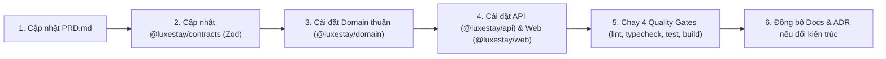

# Engineering, Maintenance & Feature Expansion Plan — LuxeStay (`travel-service`)

- **Phiên bản kế hoạch:** 3.0 (Phase 4A–4C Completed · Phase 5 Planned)
- **Ngày cập nhật:** 2026-11-25
- **Trạng thái:** Phase 0–4C Completed ✅ | Phase 5 Planned 📋
- **Tài liệu liên quan:** [PRD.md](./PRD.md) | [ARCHITECTURE.md](./ARCHITECTURE.md) | [ADR Index](./adr/README.md) | [GLOSSARY.md](../GLOSSARY.md)

---

## 1. Ảnh chụp Hiện trạng (Baseline Snapshot — 2026-11-25)

### 1.1. Các mốc kiến trúc đã hoàn thành (Completed Milestones)
| Mốc | Commit / Phiên bản | Nội dung đã hoàn tất | Hồ sơ thiết kế / ADR |
| :--- | :---: | :--- | :--- |
| **M0 — Khởi tạo MVP** | `9c20f2a` | Nền tảng đặt phòng LuxeStay với Next.js App Router, Tailwind CSS v4, Framer Motion | — |
| **M1 — Resort Amenities** | `96a3216` | Danh mục 51 tiện ích / 7 nhóm, modal chi tiết tiện ích, đồng bộ add-on vào báo giá | [Spec](./superpowers/specs/2026-11-20-resort-amenities-design.md) |
| **M2 — BookingSession Deepening** | `61cf2d6` | Deep module `bookingSession`, seed một chiều từ `SearchBar`, `BookingQuote`, seam `ReservationSubmitter` | [ADR-0002](./adr/0002-booking-session-and-authoritative-server-pricing.md) |
| **M3 — StayCatalogQuery Deepening** | `0476330` | Deep module `catalogQuery`, tìm kiếm tiếng Việt không dấu, preset giá, `ActiveFilterChip`, `QuickSearchTrend` | [ADR-0003](./adr/0003-stay-catalog-query-single-source-of-truth.md) |
| **M4 — Amenity Projection & Explorer** | `dc9d3a7` | `WeakMap` projection, Master–Detail `AmenityExplorer`, `AmenityPricingDescriptor`, xóa schema cũ | [ADR-0004](./adr/0004-amenity-projection-explorer-and-pricing-descriptors.md) |
| **M5 — Overlay Stack Coordinator** | `f467d47` | Deep module `overlayStack` + `OverlayContext`, `z-index` theo tier, 1 listener `Escape`, ref-counted scroll lock, ARIA | [ADR-0005](./adr/0005-centralized-overlay-stack-coordinator.md) |
| **M6 — Persistence & Reservation Ports** | `0f26b7b` | `AppPorts`, `FavoritesRepository` với `useSyncExternalStore`, tách hoàn toàn I/O khỏi domain | [ADR-0006](./adr/0006-app-ports-persistence-and-split-domain-contexts.md) |
| **M7 — Server API & Split Contexts** | `abedd20`, `eb4674e` | Tính giá chuẩn phía server, tách 3 domain contexts (`useFavorites`, `useCatalog`, `useBookingSession`), nâng Next.js `16.4.6` | [ADR-0002](./adr/0002-booking-session-and-authoritative-server-pricing.md), [ADR-0006](./adr/0006-app-ports-persistence-and-split-domain-contexts.md) |
| **M8 — Monorepo v0.2.0 & Phase 0 Hardening** | `bbcc2d6` (`v0.2.0`) | Chuyển đổi sang TypeScript Monorepo (`npm workspaces` + `Turborepo`): `@luxestay/contracts` (Zod), `@luxestay/domain`, `@luxestay/api` (Hono `:4000`), `@luxestay/web` (feature-based `:3000`), `NEXT_PUBLIC_DATA_MODE=api|mock` không fallback ngầm, Error Boundaries, `.nvmrc`, `apps/web/AGENTS.md` + `apps/api/AGENTS.md`, ESLint boundary toàn repo, GitHub Actions CI | [ADR-0007](./adr/0007-monorepo-hono-zod-contracts.md) |
| **M9 — Phase 1: PostgreSQL/Drizzle, Booking Lifecycle & Shareable Routing** | `bc04ca3` (`v0.3.0`) | PostgreSQL 16 + Drizzle ORM (`docker-compose.yml` `:5434->5432`, 12 bảng, migration `0000`, idempotent seed, dual driver `memory|database`), tra cứu & hủy đơn (`/bookings`, `/bookings/[bookingId]`), trang chi tiết `/stays/[id]` SSR + SEO/OpenGraph & đồng bộ URL query | [ADR-0008](./adr/0008-postgresql-drizzle-database-layer.md) |
| **M10 — Phase 2: Commercialization (Auth, Wishlist Sync, Voucher Engine & Payment Sandbox)** | `5fd6940` (`v0.4.0`) | Custom Session Auth (`scrypt` + OTP + `HttpOnly` Cookie + `OAuthProviderSeam`, `AuthContext` tách riêng), đồng bộ Wishlist `user_favorites` + lịch sử `Đơn đặt phòng của tôi` (`/api/v1/reservations/my`); Dynamic Voucher Engine (`evaluatePromotionVoucher`, `POST /api/v1/vouchers/validate`, ô áp mã trên Checkout); Payment Gateway Sandbox (`pending_payment → confirmed/payment_failed/expired`, `/payments/[transactionId]`, Webhook `HMAC-SHA256` + Idempotency + `notification_logs` email vé điện tử); Migration `0001` (19 bảng PostgreSQL 16), 75/75 tests + 13/13 live PostgreSQL E2E | [ADR-0009](./adr/0009-custom-session-auth-and-wishlist-sync.md), [ADR-0010](./adr/0010-payment-sandbox-webhook-and-notifications.md) |
| **M11 — Phase 3A: Availability Engine, Anti-Double-Booking, Seasonal Pricing & Verified Reviews** | `v0.5.0` | Quản lý tồn kho theo từng đêm (`properties.inventory_count` + `property_availability`), khóa giao dịch `SELECT ... FOR UPDATE` trên PostgreSQL / per-property async mutex trên `memory` chống đặt trùng (`409 CONFLICT`), giá theo mùa (`override > lễ VN +30% > cuối tuần T6–T7 +20% > giá gốc`) + `seasonalSurcharge` & `nightlyBreakdown`; trạng thái `completed` (`POST /api/v1/reservations/:bookingId/complete` sandbox), Đánh giá xác thực (`POST /api/v1/properties/:id/reviews`, `reviews.booking_id UNIQUE`, tự tính lại `rating` & `review_count` trong DB transaction); Migration `0002` (20 bảng PostgreSQL 16), UI `AvailabilityCalendar`, `SeasonalPricingSummary`, badge xác thực & form đánh giá, 84/84 tests + 7/7 live Postgres concurrency E2E | [ADR-0011](./adr/0011-availability-engine-seasonal-pricing-and-verified-reviews.md) |
| **M12 — Phase 3B: RBAC Host/Admin Portal, Multi-Language/Currency & Playwright E2E** | `v0.6.0` | Phân quyền RBAC (`guest \| host \| admin`) với `users.role` + `properties.owner_user_id` (Migration `0003`, seed tài khoản demo Host/Admin), toàn bộ API `/api/v1/host/*` (CRUD chỗ nghỉ có chặn xóa `409` khi có đơn hoạt động, ghi đè lịch/giá `property_availability`, danh sách đơn khách, hoàn tất lưu trú kể cả khi tắt sandbox, báo cáo doanh thu `computeHostAnalytics`); giao diện `/host` 4 tab; `LocaleContext` (`vi`/`en`, `VND`/`USD` qua `useSyncExternalStore` không đổi URL) + bộ chọn tương tác trên `Navbar`; bộ kiểm thử **Playwright Chromium E2E** (`e2e/`, `npm run test:e2e`, CI job), 90/90 unit/integration tests + 3/3 Playwright E2E + live Postgres 16 RBAC E2E | [ADR-0012](./adr/0012-rbac-host-portal-i18n-and-playwright-e2e.md) |
| **M13 — Phase 4A: Promotions Hub, Deals Center & Campaign-Scoped Vouchers** | `69763ba` (`feat/promotions-hub-deals`) | Khu vực Ưu đãi 3 tầng kiểu Traveloka trên trang chủ (Mã người dùng mới + Hero Campaign có đếm ngược + Carousel chiến dịch), trang `/deals` & `/deals/[slug]` SSR; Migration `0004_promotions_campaigns.sql` (21 bảng PostgreSQL 16), module API độc lập `apps/api/src/modules/deals/*`, `dealsPort.ts`, quy tắc server-authoritative `NEW_USER_ONLY` & `PROPERTY_NOT_ELIGIBLE` chống lách mã đồng thời; 115/115 unit/API tests + 4/4 Playwright E2E (`E2E-4`) | — |
| **M14 — Phase 4B: Modular Stay Catalog Expansion (+30 Stays) & Progressive Pagination** | `ae68e49` (`feat/catalog-expansion-30-stays`) | Mở rộng danh mục `12 → 42` chỗ nghỉ phủ đều 5 loại hình (`homestay`, `hotel`, `villa`, `resort`, `glamping`), 8 danh mục và 14 điểm đến (thêm Hạ Long, Huế, Quy Nhơn, Mộc Châu, Vũng Tàu, TP.HCM); tách seed modular theo loại hình (`packages/domain/src/seed/properties/*`); phân trang **Xem thêm / Thu gọn** (`12` chỗ nghỉ/lượt) trong `PropertyList.tsx`; backfill transactional idempotent `backfillMissingSeedProperties` (`ON CONFLICT DO NOTHING`) trong `vercelPrepare.ts`; 116/116 unit/API tests + 5/5 Playwright E2E (`E2E-5`) | — |
| **M15 — Phase 4C: Authentic Stay, Imagery Overhaul & Mobile Stability** | `Completed` (`feat/catalog-expansion-30-stays`) | Đại tu 100% bộ ảnh cho toàn bộ 42 chỗ nghỉ (`128` ô) + 8 Điểm đến (`8` ô) + 5 Banner chiến dịch (`5` ô) (`138` ảnh thật + `3` ảnh AI local, `0%` trùng lặp toàn cục `141/141`), `repairRetiredSeedImages`, `verify-seed-images.mjs`, cùng vá triệt để lỗi tràn ngang `1280px` trên mobile (`w-full min-w-0` + `overflow-x: clip`), tối ưu `CampaignHeroBanner` & `SearchBar` popover trên `360–390px`, phủ Playwright `E2E-6` | — |

### 1.2. Hiện trạng kiểm chứng kỹ thuật
- **Automated Tests (4 tầng + Media Integrity + Playwright E2E):** `117/117` unit/integration tests đạt (`contracts`: 8, `domain`: 56, `api`: 21, `web`: 32) qua `npm run test`, `141/141` ảnh sạch không trùng lặp qua `node scripts/verify-seed-images.mjs`, và **`6/6` Playwright Chromium E2E** (`E2E-1` đến `E2E-6`, bao gồm Mobile Responsive `390px`/`360px`) qua `npm run test:e2e`.
- **Lint & Typecheck:** `npm run lint` (**ESLint 9 + Import Boundaries trên cả 4 workspaces, 0 errors, 0 warnings**) và `npm run typecheck` (6/6 tasks pass).
- **Production Build & PostgreSQL 16 Schema:** `npm run build` (4/4 workspaces pass; Next.js routes: `/`, `/_not-found`, `/deals`, `/deals/[slug]`, `/stays/[id]`, `/bookings`, `/bookings/[bookingId]`, `/host`, `/payments/[transactionId]`); `21` bảng PostgreSQL 16 (migrations `0000`–`0004`), backfill idempotent an toàn cho Neon Postgres & Vercel Services.

---

## 2. Lộ trình Bảo trì & Mở rộng theo Giai đoạn (Phased Roadmap)

### Phase 0 — Technical Hardening & Monorepo Foundation (ĐÃ HOÀN THÀNH ✅)
- [x] **P0.1 — Chuẩn hóa Monorepo scripts & CI pipeline:** Root `package.json` + `turbo.json` (`dev`, `build`, `lint`, `typecheck`, `test`), `.github/workflows/ci.yml`, ESLint boundary rules ngăn import chéo FE↔BE và ngăn UI gọi thẳng `@luxestay/domain/seed`.
- [x] **P0.2 — Loại bỏ fallback ngầm & chuẩn hóa `HttpApiError`:** Chế độ `NEXT_PUBLIC_DATA_MODE=api|mock` tường minh; ở `api` mode mọi lỗi `4xx`/`5xx`/mạng đều ném `HttpApiError` trung thực, được phủ test trong `apps/web/tests/persistence-port.test.ts`.
- [x] **P0.3 — Đồng bộ tài liệu, Error Boundaries & dọn dẹp cấu hình:** Thêm `error.tsx`, `global-error.tsx`, `not-found.tsx`, xóa `tailwind.config.mjs` & `date-fns` thừa, xóa cảnh báo `MODULE_TYPELESS_PACKAGE_JSON`, đồng bộ `GLOSSARY.md` / `PRD.md` / `ARCHITECTURE.md` / `ADR-0007`.

---

### Phase 1 — Backend Persistence & Shareable Routing (ĐÃ HOÀN THÀNH ✅)
**Mục tiêu:** Thay `InMemory` / `Seed` repository trong `apps/api` bằng cơ sở dữ liệu thật (giữ `STORAGE_DRIVER=memory` song song cho CI/test) và mở khóa SEO + quản lý đơn + liên kết chia sẻ trực tiếp.

- [x] **P1.1 — Database Schema & Repository Adapter trên `apps/api` ([ADR-0008](./adr/0008-postgresql-drizzle-database-layer.md)):**
  - Chọn **PostgreSQL 16 + Drizzle ORM** (`drizzle-orm`, `pg`, `drizzle-kit`) cô lập hoàn toàn trong `apps/api` kèm `docker-compose.yml` tại root.
  - Tạo 12 bảng chuẩn hóa (`categories`, `destinations`, `promotions`, `testimonials`, `amenity_categories`, `amenity_filter_options`, `amenity_catalog`, `properties`, `property_amenities`, `reviews`, `reservations`, `reservation_amenities`), migration `0000_initial.sql`, `npm run db:migrate`, và `npm run db:seed` idempotent từ `@luxestay/domain/seed`.
  - Cài đặt `createPostgresCatalogRepository` và `createPostgresReservationRepository` thỏa các seam `ApiCatalogRepository`, `ApiReservationRepository` khi `STORAGE_DRIVER=database`, tự đóng pool gọn khi `SIGINT`/`SIGTERM`.
- [x] **P1.2 — Tra cứu & Hủy Đơn đặt phòng:**
  - Bổ sung hợp đồng Zod trong `@luxestay/contracts` (`ReservationStatusSchema`, `ReservationLookupInputSchema`, `CancelReservationInputSchema`, `FORBIDDEN`, `CONFLICT`) và hàm thuần `matchesReservationContact`, `evaluateReservationCancellation` trong `@luxestay/domain`.
  - Bổ sung `GET /api/v1/reservations/:bookingId?contact=...` và `PATCH /api/v1/reservations/:bookingId/cancel` (xác thực email không phân biệt hoa/thường hoặc SĐT VN `0`/`+84`/`84`, kiểm tra chính sách `freeCancellation` và chống hủy trùng bằng `409 CONFLICT`).
  - Xây dựng `ReservationManagerPort` (HTTP / `localStorage` mock / in-memory), trang `/bookings`, `/bookings/[bookingId]`, nút **"Tra cứu đơn"** trên `Navbar` và nút **"Quản lý / Tra cứu đơn đặt phòng"** trên `BookingSuccessModal`.
- [x] **P1.3 — Dynamic Property Pages & URL Query Sync:**
  - Tạo route `/stays/[id]` (Server Component gọi `loadPropertyById`, `generateMetadata` cho SEO/OpenGraph, `notFound()` khi không tồn tại) + liên kết từ `PropertyCard` (crawlable title link) và `PropertyModal` (nút "Trang chi tiết" + nút Chia sẻ copy đúng `/stays/[id]`).
  - Thêm bộ chuyển đổi thuần `serializeCatalogQueryToSearchParams` / `parseCatalogQueryFromSearchParams` trong `packages/domain/src/catalogQuery.ts` và component `CatalogUrlSync` đồng bộ 2 chiều URL trang chủ (`/`).

---

### Phase 2 — Authentication, Dynamic Vouchers & Real Payments (ĐÃ HOÀN THÀNH ✅)
**Mục tiêu:** Chuyển các luồng đang ở mức UI prototype sang tính năng thương mại đầy đủ.

- [x] **P2.1 — Xác thực Người dùng & Đồng bộ Wishlist ([ADR-0009](./adr/0009-custom-session-auth-and-wishlist-sync.md)):**
  - Hoàn thiện `AuthModal` (3 tab Đăng nhập / Đăng ký / OTP nhanh) + `apps/api/src/modules/auth` (`scrypt` + OTP + `HttpOnly` Session Cookie + `OAuthProviderSeam`) và `AuthContext` tách riêng trong `apps/web/src/features/auth/`.
  - Cài đặt đồng bộ Wishlist theo `userId` (`GET`/`PUT`/`POST /api/v1/favorites`, bảng `user_favorites`, tự động merge từ `localStorage` khi đăng nhập) và hiển thị lịch sử **"Đơn đặt phòng của bạn"** (`GET /api/v1/reservations/my`).
- [x] **P2.2 — Hệ thống Mã giảm giá động (Voucher Engine):**
  - Thay `SERVICE_DISCOUNT = 100000` cố định bằng module thuần `evaluatePromotionVoucher` (`packages/domain/src/vouchers.ts`), bổ sung `POST /api/v1/vouchers/validate`, `promoCode` vào `ServerReservationIntentSchema`, lưu quy tắc động trong bảng `promotions` và ô áp mã kèm chọn nhanh trên `BookingCheckoutModal`.
- [x] **P2.3 — Tích hợp Cổng thanh toán Sandbox & Thông báo ([ADR-0010](./adr/0010-payment-sandbox-webhook-and-notifications.md)):**
  - Mở rộng trạng thái đơn: `pending_payment` → `confirmed` / `payment_failed` / `expired` / `cancelled` (`hotel` xác nhận ngay; `vnpay`/`momo`/`card` qua cổng `/payments/[transactionId]`).
  - Triển khai Webhook `POST /api/v1/payments/webhook/:provider` xác thực chữ ký `HMAC-SHA256` + chống xử lý trùng idempotency (`payment_webhook_events`) và ghi email vé điện tử vào `notification_logs` (hiển thị bản xem trước email trên `/bookings/[bookingId]`).

---

### Phase 3A — Availability Engine, Seasonal Pricing & Verified Reviews (ĐÃ HOÀN THÀNH ✅ — `v0.5.0`)
- [x] **P3.1 — Quản lý Lịch trống, Chống đặt trùng & Giá theo mùa ([ADR-0011](./adr/0011-availability-engine-seasonal-pricing-and-verified-reviews.md)):**
  - Bổ sung `properties.inventory_count` (`1` cho villa/homestay/glamping, `5` cho hotel, `6` cho resort) và bảng `property_availability` (Migration `0002`, 20 bảng PostgreSQL 16).
  - Khóa giao dịch `SELECT ... FOR UPDATE` trên PostgreSQL (và per-property async mutex trên `memory`) trong `POST /api/v1/reservations` ngăn tuyệt đối double-booking (`409 CONFLICT`), tự động giải phóng phòng khi đơn hủy/hết hạn/thất bại thanh toán/hoàn tất.
  - Module thuần `packages/domain/src/availability.ts` + tích hợp `deriveBookingQuote`: thứ tự ưu tiên giá `overridePrice > ngày lễ cố định VN (+30%) > cuối tuần T6–T7 (+20%) > giá chuẩn`, nhân theo `guests.rooms`, hiển thị `seasonalSurcharge` & `nightlyBreakdown` qua `AvailabilityCalendar` và `SeasonalPricingSummary`.
- [x] **P3.2 — Đánh giá xác thực (Verified Reviews) ([ADR-0011](./adr/0011-availability-engine-seasonal-pricing-and-verified-reviews.md)):**
  - Bổ sung trạng thái đơn `completed` + `POST /api/v1/reservations/:bookingId/complete` (chế độ Sandbox / Host & Admin ở 3B).
  - Triển khai `POST /api/v1/properties/:id/reviews` kiểm tra chủ đơn + điều kiện đã hoàn tất lưu trú (hoặc đã qua 12:00 ngày `checkOut`), chống đánh giá trùng bằng `reviews.booking_id UNIQUE` (`409 CONFLICT`), cập nhật atomic `properties.rating` & `properties.review_count` trong DB transaction và hiển thị badge **"Đã xác thực lưu trú"** + form gửi đánh giá trên `/bookings/[bookingId]`.

### Phase 3B — Host/Admin Portal, Multi-language & Playwright E2E (ĐÃ HOÀN THÀNH ✅ — `v0.6.0`)
- [x] **P3.3 — Cổng Chủ nhà & Quản trị (Host/Admin Portal) ([ADR-0012](./adr/0012-rbac-host-portal-i18n-and-playwright-e2e.md)):**
  - Phân quyền RBAC (`guest | host | admin`) qua `users.role` & `properties.owner_user_id` (Migration `0003`, seed tài khoản demo `host@luxestay.vn` & `admin@luxestay.vn`).
  - Triển khai đầy đủ API `/api/v1/host/*` (CRUD chỗ nghỉ có bảo vệ `409` khi còn đơn hoạt động, ghi đè lịch/giá `property_availability`, danh sách đơn khách, báo cáo doanh thu `computeHostAnalytics`) và mở quyền Host/Admin hoàn tất lưu trú kể cả khi tắt sandbox.
  - Xây dựng giao diện `/host` 4 tab (Analytics + biểu đồ tháng, Chỗ nghỉ CRUD, Lịch phòng & Giá đặc biệt kèm `AvailabilityCalendar`, Đơn đặt phòng khách) với cổng kiểm soát RBAC và đăng nhập thử nhanh.
- [x] **P3.4 — Đa ngôn ngữ (`vi`/`en`), Đa tiền tệ (`VND`/`USD`) & Kiểm thử E2E (Playwright) ([ADR-0012](./adr/0012-rbac-host-portal-i18n-and-playwright-e2e.md)):**
  - Module thuần `packages/domain/src/locale.ts` (`translate`, `formatMoney`, tỷ giá `25.000 VNĐ/USD`) + `LocaleContext` tách riêng (`useSyncExternalStore` với `localStorage`, không đổi URL, không lỗi SSR hydration) gắn bộ chuyển đổi trực tiếp `VNĐ/USD` & `VI/EN` trên `Navbar`.
  - Bộ kiểm thử **Playwright Chromium E2E** (`playwright.config.ts`, `e2e/luxestay.spec.ts`, `npm run test:e2e`) và tích hợp tự động vào `.github/workflows/ci.yml`.

---

### Phase 4A — Promotions Hub, Deals Center & Campaign-Scoped Vouchers (ĐÃ HOÀN THÀNH ✅ — `feat/promotions-hub-deals`, `69763ba`)
**Mục tiêu:** Cung cấp trung tâm ưu đãi đang diễn ra rõ ràng ngay trên trang chủ và trang chuyên mục riêng, đi kèm ràng buộc mã giảm giá chuẩn phía server.

- [x] **P4.1 — Promotions Hub 3 tầng, `/deals`, `/deals/[slug]` & Server-Authoritative Rules:**
  - Mở rộng hợp đồng Zod (`PromotionVoucherSchema`, `PromotionCampaignSchema`, `DealsSnapshotSchema`, `DealDetailResponseSchema`) và module domain `packages/domain/src/deals.ts`.
  - Migration `0004_promotions_campaigns.sql` (thêm `promotion_campaigns` + mở rộng cột `promotions`), module API độc lập `apps/api/src/modules/deals/*`, `dealsPort.ts` trên `apps/web`.
  - Chặn nghiêm ngặt phía server các quy tắc `NEW_USER_ONLY` (kiểm tra trong transaction lock bằng `hasSuccessfulBookingByUserId`), `PROPERTY_NOT_ELIGIBLE`, và `404` với `propertyId` không tồn tại.
  - Phủ kiểm thử Playwright `E2E-4` (banner ưu đãi, modal điều kiện mã, `/deals`, `/deals/[slug]` tự động điền mã sang checkout).

### Phase 4B — Modular Stay Catalog Expansion (+30 Stays) & Progressive Pagination (ĐÃ HOÀN THÀNH ✅ — `feat/catalog-expansion-30-stays`, `ae68e49`)
**Mục tiêu:** Làm phong phú nguồn cung chỗ nghỉ toàn quốc trên kiến trúc seed tách module sẵn sàng mở rộng dịch vụ mới, đồng thời tối ưu trải nghiệm duyệt danh sách dài.

- [x] **P4.2 — Mở rộng +30 chỗ nghỉ đa loại hình (`stay-13`–`stay-42`) & Phân trang Xem thêm:**
  - Tách cấu trúc seed theo loại hình dưới `packages/domain/src/seed/properties/` (`homestays.ts`, `hotels.ts`, `villas.ts`, `resorts.ts`, `glamping.ts`), nâng tổng danh mục từ `12` lên `42` chỗ nghỉ phủ 14 điểm đến (thêm Hạ Long, Huế, Quy Nhơn, Mộc Châu, Vũng Tàu, TP. Hồ Chí Minh).
  - Thêm phân trang tiến triển trên `PropertyList.tsx` (`12` chỗ nghỉ ban đầu, `+12` mỗi lượt Xem thêm, nút Thu gọn, tự động reset khi thay đổi bộ lọc, hỗ trợ VI/EN).
  - Bổ sung `backfillMissingSeedProperties` chạy giao dịch `ON CONFLICT DO NOTHING` trong `vercelPrepare.ts` đảm bảo không ghi đè chỗ nghỉ đã tồn tại.
  - Phủ kiểm thử Playwright `E2E-5` (42 kết quả, nạp 12 → 24 → thu gọn 12, lọc điểm đến mới Hạ Long).

### Phase 4C — Authentic Stay & Destination Imagery Overhaul (ĐÃ HOÀN THÀNH ✅ — `feat/catalog-expansion-30-stays`)
**Mục tiêu:** Loại bỏ triệt để tình trạng trùng lặp hình ảnh và ảnh minh họa sai bối cảnh ("treo đầu dê bán thịt chó") trên toàn bộ 42 chỗ nghỉ và 8 Điểm đến nổi bật.

- [x] **P4.3 — Đại tu 136 ảnh thực tế (42 chỗ nghỉ × 3–4 ảnh + 8 Điểm đến) theo chuẩn 4 trục:**
  - Áp dụng mô hình **Hybrid ưu tiên ảnh chụp thực tế** (`138` ảnh thực Pexels/Unsplash + `3` ảnh AI local nén nhẹ trong `apps/web/public/images/stays/` cho `stay-01`, `stay-15`, `stay-18`).
  - Đạt **0% trùng lặp toàn cục** (`141/141` ảnh riêng biệt giữa 42 chỗ nghỉ, 8 Điểm đến và 5 Banner chiến dịch) và duyệt trực quan theo hàng trên contact-sheet theo **4 trục chân thực**: Loại hình × Vùng miền × Phân khúc giá × Tiện ích thực tế có trong `resortAmenities`.
- [x] **P4.4 — Đồng bộ DB có điều kiện an toàn & Hàng rào kiểm thử tự động:**
  - Bổ sung `repairRetiredSeedImages(db)` trong `apps/api/src/db/vercelPrepare.ts` dùng bảng đối chiếu `RETIRED_SEED_*` (`packages/domain/src/seed/retiredImages.ts`, chỉ cập nhật khi DB đang lưu chính xác URL seed cũ, bảo toàn 100% ảnh do Host/Admin tự sửa; đã phủ test trong `apps/api/tests/api.test.ts`).
  - Cập nhật `apps/web/next.config.ts` (bổ sung `images.pexels.com`, giữ nguyên `images.unoptimized: true`), nâng cấp unit test cưỡng chế `0%` trùng lặp + kiểm tra tồn tại file local trong `properties-amenities.test.ts`, và bổ sung script `scripts/verify-seed-images.mjs` kiểm tra `HTTP 200` + `content-type: image/*`.
- [x] **P4.5 — Vá triệt để tràn layout mobile & Kiểm thử Responsive (`E2E-6`):**
  - Thêm `w-full min-w-0` cho container chính và các section chứa carousel (`page.tsx`, `layout.tsx`, `PromotionsHub.tsx`, `HorizontalCarouselShell.tsx`, `PropertyList.tsx`, `TestimonialsSection.tsx`), dùng `overflow-x: clip` trên `html, body` để ngăn auto-zoom-out mà không phá `position: sticky`.
  - Làm gọn `CampaignHeroBanner` và giới hạn chiều rộng `SearchBar` popover (`max-w-[calc(100vw-2.5rem)]`) trên màn hình nhỏ; bổ sung Playwright `E2E-6` xác minh `scrollWidth <= innerWidth` trên `390×844` và `360×800` cho cả 6 route & popover.

---

### Phase 5 — Multi-Service Travel Expansion: Activities, Tours & Transfers (LỘ TRÌNH KẾ TIẾP 📋 — Tách nhánh mới sau Phase 4C)
**Mục tiêu:** Mở rộng LuxeStay từ nền tảng lưu trú sang hệ sinh thái dịch vụ du lịch đa mảng mà vẫn bảo toàn chặt biên kiến trúc `@luxestay/contracts` → `@luxestay/domain` → `apps/api` & `apps/web`.

- [ ] **P5.1 — Hợp đồng & Domain Dịch vụ Hoạt động/Tour & Đưa đón (`activities` & `transfers`):**
  - Định nghĩa Zod schema cho `TravelActivity`, `ActivitySlot`, `TransferService`, `ServiceBookingIntent` trong `@luxestay/contracts`.
  - Tách module seed `packages/domain/src/seed/activities/*` và hàm thuần lọc/báo giá/kiểm tra suất hoạt động trong `@luxestay/domain`.
- [ ] **P5.2 — Backend Persistence (Migration `0005`), API độc lập & Cross-Sell cùng Voucher:**
  - Migration `0005_travel_activities.sql`, module API cô lập `apps/api/src/modules/activities/*` hỗ trợ đặt độc lập hoặc đính kèm vào chuyến lưu trú (`stay + activity` bundle) và áp dụng mã ưu đãi từ Promotions Hub.
- [ ] **P5.3 — Giao diện Khám phá Hoạt động (`/activities`, `/activities/[slug]`) & E2E-7:**
  - Cổng `activitiesPort.ts`, giao diện lọc theo điểm đến/loại trải nghiệm/khung giờ, trang chi tiết SSR + đặt vé nhanh và kịch bản Playwright `E2E-7`.

---

## 3. Quy trình Kiểm soát, Bảo trì & Mở rộng Tính năng



### 3.1. Quality Gates bắt buộc trước khi Merge / Release
```bash
npm run lint
npm run typecheck
npm run test
npm run build
```

### 3.2. Definition of Done (DoD) cho mỗi Tính năng / PR
1. Mọi dữ liệu qua mạng có Zod schema trong `@luxestay/contracts` và dùng chung ở cả `apps/api` lẫn `apps/web`.
2. Logic nghiệp vụ thuần nằm trong `@luxestay/domain`, không trộn logic tính toán phức tạp vào React JSX hay Hono route handler.
3. Không vi phạm ESLint import boundary rules (`apps/web` không import `apps/api`; `features/*` và `app/*` không import `@luxestay/domain/seed`).
4. Modal/Drawer mới đăng ký qua `useOverlayLayer` (`apps/web/src/shared/overlay/`) với đầy đủ `role="dialog"`, `aria-modal="true"`.
5. Có unit/integration test tương ứng ở tầng thích hợp (`contracts`, `domain`, `api`, `web`) và pass 100% 4 lệnh Quality Gates.
6. Cập nhật `docs/PRD.md`, `docs/ARCHITECTURE.md`, `docs/PLAN.md`, `GLOSSARY.md` (và thêm `docs/adr/NNNN-*.md` nếu có quyết định kiến trúc mới).

---

## 4. Ma trận Quản trị Rủi ro (Risk Register)

| Rủi ro | Mức độ | Dấu hiệu nhận biết | Biện pháp giảm thiểu |
| :--- | :---: | :--- | :--- |
| **Lệch hợp đồng FE ↔ BE khi nâng cấp API** | Cao | Response từ `apps/api` bị `CONTRACT_MISMATCH` trên `apps/web` | Mọi thay đổi API bắt buộc đi qua `@luxestay/contracts` trước; CI chạy đồng thời test cả 4 workspaces |
| **Quên cấu hình CORS / URL khi deploy FE & BE tách rời** | Trung bình | Trình duyệt chặn `POST /api/v1/reservations` hoặc SSR báo `NETWORK_ERROR` | Validate env bằng Zod khi khởi động (`apps/api/src/config/env.ts`, `apps/web/src/shared/config/env.ts`); dùng `.env.example` làm chuẩn cấu hình deploy |
| **Phình to `BookingContext.tsx` khi thêm miền mới** | Trung bình | Nhiều state không liên quan dồn chung 1 provider | Tạo Context/Feature riêng (ví dụ `features/auth/AuthContext.tsx`) thay vì nhồi vào `BookingContext` |
| **Double-booking khi nối Database ở Phase 1–3** | Đã kiểm soát (P3.1 ✅) | 2 khách cùng đặt 1 chỗ nghỉ trùng ngày | Đã khóa giao dịch hàng `SELECT ... FOR UPDATE` trong `createWithPropertyLock` (PostgreSQL) & per-property mutex (`memory`), kiểm chứng 3-way concurrent race `[201, 409, 409]` |
| **Quên build `packages/*` khi phát triển riêng 1 app** | Thấp | `apps/api` hoặc `apps/web` đọc `dist/` cũ của `packages/*` | Luôn chạy qua root script `npm run dev` / `npm run dev:web` / `npm run dev:api` (Turborepo tự chạy `^build` và watch) |
| **Trùng lặp / sai lệch hình ảnh minh họa chỗ nghỉ & link ảnh bên ngoài bị gỡ** | Cao | Nhiều chỗ nghỉ dùng chung ảnh bìa hoặc ảnh sai khu vực/tiện ích (treo đầu dê bán thịt chó), hoặc URL remote trả 404 | Cưỡng chế `0%` trùng lặp toàn cục qua unit test (`properties-amenities.test.ts`), kiểm duyệt 4 trục chân thực + contact-sheet, chạy `scripts/verify-seed-images.mjs` xác minh `HTTP 200` / file local tồn tại, và chỉ cập nhật DB qua `repairRetiredSeedImages` có điều kiện |
