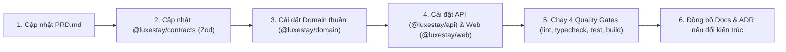

# Engineering, Maintenance & Feature Expansion Plan — LuxeStay (`travel-service`)

- **Phiên bản kế hoạch:** 2.0 (Monorepo Baseline v0.2.0)
- **Ngày cập nhật:** 2026-11-24
- **Trạng thái:** Active Roadmap
- **Tài liệu liên quan:** [PRD.md](./PRD.md) | [ARCHITECTURE.md](./ARCHITECTURE.md) | [ADR Index](./adr/README.md) | [GLOSSARY.md](../GLOSSARY.md)

---

## 1. Ảnh chụp Hiện trạng (Baseline Snapshot — 2026-11-24)

### 1.1. Các mốc kiến trúc đã hoàn thành (Completed Milestones)
| Mốc | Commit / Phiên bản | Nội dung đã hoàn tất | Hồ sơ thiết kế / ADR |
| :--- | :---: | :--- | :--- |
| **M0 — Khởi tạo MVP** | `9c20f2a` | Nền tảng đặt phòng LuxeStay với Next.js App Router, Tailwind CSS v4, Framer Motion | — |
| **M1 — Resort Amenities** | `96a3216` | Danh mục 51 tiện ích / 7 nhóm, modal chi tiết tiện ích, đồng bộ add-on vào báo giá | [Spec](./superpowers/specs/2026-11-20-resort-amenities-design.md) |
| **M2 — BookingSession Deepening** | `61cf2d6` | Deep module `bookingSession`, seed một chiều từ `SearchBar`, `BookingQuote`, seam `ReservationSubmitter` | [ADR-0002](./adr/0002-booking-session-and-authoritative-server-pricing.md) |
| **M3 — StayCatalogQuery Deepening** | `0476330` | Deep module `catalogQuery`, tìm kiếm tiếng Việt không dấu, preset giá, `ActiveFilterChip`, `QuickSearchTrend` | [ADR-0003](./adr/0003-stay-catalog-query-single-source-of-truth.md) |
| **M4 — Amenity Projection & Explorer** | `dc9d3a7` | `WeakMap` projection, Master–Detail `AmenityExplorer`, `AmenityPricingDescriptor`, xóa schema cũ | [ADR-0004](./adr/0004-amenity-projection-explorer-and-pricing-descriptors.md) |
| **M5 — Overlay Stack Coordinator** | `f467d47` | Deep module `overlayStack` + `OverlayContext`, `z-index` theo tier, 1 listener `Escape`, ref-counted scroll lock, ARIA | [ADR-0005](./adr/0005-centralized-overlay-stack-coordinator.md) |
| **M6 — Persistence & Reservation Ports** | `0f26b7b` | `AppPorts`, `FavoritesRepository` với `useSyncExternalStore`, tách hoàn toàn I/O khỏi domain | [ADR-0006](./adr/0006-app-ports-persistence-and-split-domain-contexts.md) |
| **M7 — Server API & Split Contexts** | `abedd20`, `eb4674e` | Tính giá chuẩn phía server, tách 3 domain contexts (`useFavorites`, `useCatalog`, `useBookingSession`), nâng Next.js `16.4.6` | [ADR-0002](./adr/0002-booking-session-and-authoritative-server-pricing.md), [ADR-0006](./adr/0006-app-ports-persistence-and-split-domain-contexts.md) |
| **M8 — Monorepo v0.2.0 & Phase 0 Hardening** | `v0.2.0` | Chuyển đổi sang TypeScript Monorepo (`npm workspaces` + `Turborepo`): `@luxestay/contracts` (Zod), `@luxestay/domain`, `@luxestay/api` (Hono `:4000` + khung `src/db/` Phase 1), `@luxestay/web` (feature-based `:3000`), `NEXT_PUBLIC_DATA_MODE=api|mock` không fallback ngầm, Error Boundaries, `.nvmrc`, `apps/web/AGENTS.md` + `apps/api/AGENTS.md`, ESLint boundary toàn repo (`eslint.boundaries.mjs`), GitHub Actions CI, 61/61 tests | [ADR-0007](./adr/0007-monorepo-hono-zod-contracts.md) |

### 1.2. Hiện trạng kiểm chứng kỹ thuật
- **Automated Tests (4 tầng):** `61/61` đạt (`contracts`: 3, `domain`: 37, `api`: 6, `web`: 15) qua `npm run test`.
- **Lint & Typecheck:** `npm run lint` (**ESLint 9 + Import Boundaries trên cả 4 workspaces, 0 errors, 0 warnings**) và `npm run typecheck` (6/6 tasks pass).
- **Production Build & Live Smoke:** `npm run build` (4/4 workspaces pass); kiểm chứng sống cả `api` mode (online + offline strict error) lẫn `mock` mode độc lập.

---

## 2. Lộ trình Bảo trì & Mở rộng theo Giai đoạn (Phased Roadmap)

### Phase 0 — Technical Hardening & Monorepo Foundation (ĐÃ HOÀN THÀNH ✅)
- [x] **P0.1 — Chuẩn hóa Monorepo scripts & CI pipeline:** Root `package.json` + `turbo.json` (`dev`, `build`, `lint`, `typecheck`, `test`), `.github/workflows/ci.yml`, ESLint boundary rules ngăn import chéo FE↔BE và ngăn UI gọi thẳng `@luxestay/domain/seed`.
- [x] **P0.2 — Loại bỏ fallback ngầm & chuẩn hóa `HttpApiError`:** Chế độ `NEXT_PUBLIC_DATA_MODE=api|mock` tường minh; ở `api` mode mọi lỗi `4xx`/`5xx`/mạng đều ném `HttpApiError` trung thực, được phủ test trong `apps/web/tests/persistence-port.test.ts`.
- [x] **P0.3 — Đồng bộ tài liệu, Error Boundaries & dọn dẹp cấu hình:** Thêm `error.tsx`, `global-error.tsx`, `not-found.tsx`, xóa `tailwind.config.mjs` & `date-fns` thừa, xóa cảnh báo `MODULE_TYPELESS_PACKAGE_JSON`, đồng bộ `GLOSSARY.md` / `PRD.md` / `ARCHITECTURE.md` / `ADR-0007`.

---

### Phase 1 — Backend Persistence & Shareable Routing (Tiếp theo — Nền tảng Production)
**Mục tiêu:** Thay `InMemory` / `Seed` repository trong `apps/api` bằng cơ sở dữ liệu thật và mở khóa SEO + liên kết chia sẻ trực tiếp.

- [ ] **P1.1 — Database Schema & Repository Adapter trên `apps/api` (cần ADR-0008):**
  - Chọn công nghệ DB/ORM (ví dụ PostgreSQL + Drizzle hoặc Prisma) và ghi `ADR-0008`.
  - Tạo schema & migration cho `properties`, `amenity_catalog`, `property_amenities`, `reservations`, `reservation_amenities`, `reviews` kèm script seed từ `@luxestay/domain/seed`.
  - Cài đặt `PostgresCatalogRepository` và `PostgresReservationRepository` thỏa các seam có sẵn (`ApiCatalogRepository`, `ApiReservationRepository`) trong `apps/api/src/modules/`.
- [ ] **P1.2 — Tra cứu & Hủy Đơn đặt phòng:**
  - Bổ sung hợp đồng Zod trong `@luxestay/contracts` và endpoint `GET /api/v1/reservations/:bookingId`, `PATCH /api/v1/reservations/:bookingId/cancel` (kiểm tra chính sách `freeCancellation`).
  - Xây dựng trang `/bookings` và `/bookings/[bookingId]` trong `apps/web/src/app/(main)/`.
- [ ] **P1.3 — Dynamic Property Pages & URL Query Sync:**
  - Tạo route `/stays/[id]` (Server Component gọi `GET /api/v1/properties/:id` + `generateMetadata` cho SEO/OpenGraph).
  - Thêm bộ chuyển đổi thuần `serializeCatalogQueryToParams` / `parseCatalogQueryFromParams` trong `packages/domain/src/catalogQuery.ts` để đồng bộ URL trang chủ.

---

### Phase 2 — Authentication, Dynamic Vouchers & Real Payments (Thương mại hóa)
**Mục tiêu:** Chuyển các luồng đang ở mức UI prototype sang tính năng thương mại đầy đủ.

- [ ] **P2.1 — Xác thực Người dùng & Đồng bộ Wishlist (cần ADR mới):**
  - Hoàn thiện `AuthModal` + `apps/api/src/modules/auth` (Google OAuth / OTP) và `AuthContext` riêng trong `apps/web/src/features/auth/`.
  - Cài đặt `RemoteFavoritesAdapter` thỏa `FavoritesRepository` để đồng bộ Wishlist theo `userId` (merge từ `localStorage` khi đăng nhập).
- [ ] **P2.2 — Hệ thống Mã giảm giá động (Voucher Engine):**
  - Thay `SERVICE_DISCOUNT = 100000` cố định bằng hàm thuần `evaluatePromotionVoucher` trong `packages/domain`, bổ sung `promoCode` vào `ServerReservationIntentSchema` (`@luxestay/contracts`) và ô áp mã trên `BookingCheckoutModal`.
- [ ] **P2.3 — Tích hợp Cổng thanh toán & Thông báo (cần ADR mới):**
  - Mở rộng trạng thái đơn: `pending_payment` → `confirmed` / `payment_failed` / `expired` / `cancelled`.
  - Tích hợp sandbox VNPAY / MoMo / Stripe với webhook xác thực chữ ký + idempotency và gửi email xác nhận vé điện tử.

---

### Phase 3 — Availability Engine, Verified Reviews & Host Portal (Mở rộng Nền tảng)
- [ ] **P3.1 — Quản lý Lịch trống & Giá theo mùa:** Bảng `property_availability`, khóa giao dịch DB chống double-booking và phụ thu cuối tuần/lễ trong `deriveBookingQuote`.
- [ ] **P3.2 — Đánh giá xác thực (Verified Reviews):** Chỉ khách có đơn hoàn tất mới gửi review; tự tính lại `rating` & `reviewCount`.
- [ ] **P3.3 — Cổng Chủ nhà & Quản trị (Host/Admin Portal):** CRUD chỗ nghỉ, tiện ích, lịch phòng và báo cáo doanh thu.
- [ ] **P3.4 — Đa ngôn ngữ (`vi`/`en`), Đa tiền tệ & Kiểm thử E2E (Playwright).**

---

## 3. Quy trình Kiểm soát, Bảo trì & Mở rộng Tính năng



### 3.1. Quality Gates bắt buộc trước khi Merge / Release
```bash
npm run lint
npm run typecheck
npm run test
npm run build
```

### 3.2. Definition of Done (DoD) cho mỗi Tính năng / PR
1. Mọi dữ liệu qua mạng có Zod schema trong `@luxestay/contracts` và dùng chung ở cả `apps/api` lẫn `apps/web`.
2. Logic nghiệp vụ thuần nằm trong `@luxestay/domain`, không trộn logic tính toán phức tạp vào React JSX hay Hono route handler.
3. Không vi phạm ESLint import boundary rules (`apps/web` không import `apps/api`; `features/*` và `app/*` không import `@luxestay/domain/seed`).
4. Modal/Drawer mới đăng ký qua `useOverlayLayer` (`apps/web/src/shared/overlay/`) với đầy đủ `role="dialog"`, `aria-modal="true"`.
5. Có unit/integration test tương ứng ở tầng thích hợp (`contracts`, `domain`, `api`, `web`) và pass 100% 4 lệnh Quality Gates.
6. Cập nhật `docs/PRD.md`, `docs/ARCHITECTURE.md`, `docs/PLAN.md`, `GLOSSARY.md` (và thêm `docs/adr/NNNN-*.md` nếu có quyết định kiến trúc mới).

---

## 4. Ma trận Quản trị Rủi ro (Risk Register)

| Rủi ro | Mức độ | Dấu hiệu nhận biết | Biện pháp giảm thiểu |
| :--- | :---: | :--- | :--- |
| **Lệch hợp đồng FE ↔ BE khi nâng cấp API** | Cao | Response từ `apps/api` bị `CONTRACT_MISMATCH` trên `apps/web` | Mọi thay đổi API bắt buộc đi qua `@luxestay/contracts` trước; CI chạy đồng thời test cả 4 workspaces |
| **Quên cấu hình CORS / URL khi deploy FE & BE tách rời** | Trung bình | Trình duyệt chặn `POST /api/v1/reservations` hoặc SSR báo `NETWORK_ERROR` | Validate env bằng Zod khi khởi động (`apps/api/src/config/env.ts`, `apps/web/src/shared/config/env.ts`); dùng `.env.example` làm chuẩn cấu hình deploy |
| **Phình to `BookingContext.tsx` khi thêm miền mới** | Trung bình | Nhiều state không liên quan dồn chung 1 provider | Tạo Context/Feature riêng (ví dụ `features/auth/AuthContext.tsx`) thay vì nhồi vào `BookingContext` |
| **Double-booking khi nối Database ở Phase 1–3** | Cao | 2 khách cùng đặt 1 chỗ nghỉ trùng ngày | Áp dụng DB transaction + ràng buộc khoảng ngày ở **P3.1** |
| **Quên build `packages/*` khi phát triển riêng 1 app** | Thấp | `apps/api` hoặc `apps/web` đọc `dist/` cũ của `packages/*` | Luôn chạy qua root script `npm run dev` / `npm run dev:web` / `npm run dev:api` (Turborepo tự chạy `^build` và watch) |
